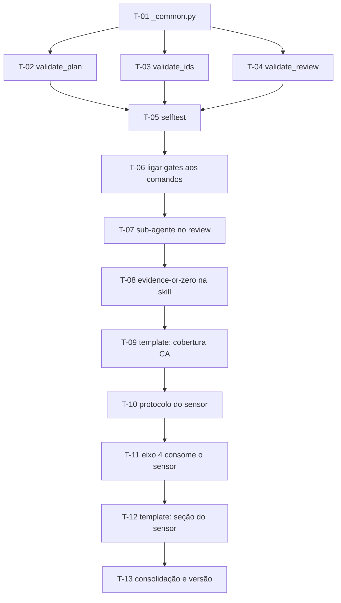

# Plano de Execução: Hardening da camada de verificação do leanwork-sdd

**PRD de referência:** nenhum — plano derivado de análise comparativa, não de PRD formal (ver seção 3)
**Cliente/Produto:** Leanwork — plugin `leanwork-sdd` (o próprio repositório)
**Stack:** Markdown (skills e comandos do Claude Code) + Python 3 stdlib (scripts de validação, sem dependências externas)
**Autor:** Mick Banagouro
**Data:** 2026-09-22
**Status:** Concluído

---

## 1. Resumo executivo *(obrigatória)*

O pipeline SDD Leanwork hoje é inteiramente **prosa instrutiva**: toda regra crítica — "não marcar Concluído com teste vermelho", "parar se o ID referenciado não existir", "cada finding cita arquivo e linha" — é uma frase em markdown que o agente pode simplesmente não aplicar numa dada execução. Não existe nada no repositório que falhe com exit code diferente de zero. Além disso, `/leanwork-execute` e `/leanwork-review` rodam no mesmo contexto: quem implementou revisa a própria implementação com o raciocínio inteiro ainda em memória.

Este plano corrige três lacunas, nesta ordem: **(1)** converte as regras mais caras de esquecer em três scripts Python determinísticos com exit code; **(2)** faz `/leanwork-review` despachar um sub-agente de contexto limpo, separando autor de verificador; **(3)** adiciona ao eixo 4 do reviewer um sensor de discriminação por injeção de falha, que responde "este teste pegaria o bug?" em vez de apenas "este teste existe e passa?".

Nada aqui altera o escopo do pipeline, a matriz de rastreabilidade `ADR ↔ RN ↔ CA ↔ UI ↔ T ↔ R`, o Gherkin PT-BR ou a estrutura de seis skills. A quebra é horizontal (padrão do pipeline): fundação de scripts → ligação aos comandos → verificação independente → sensor → consolidação.

## 2. Estratégia de entrega *(obrigatória)*

**Modelo de entrega:** incremental por fase, na branch `improvement/comparativo-tlc-spec-driven`. Cada fase fecha um valor coerente e pode ser interrompida sem deixar o plugin quebrado — os scripts nascem inertes (Fase 1) e só passam a ser invocados na Fase 2.

**Critério geral de "pronto":**

- Os três validadores rodam em `python` e `python3`, com exit 0 em artefato válido e exit 1 em cada modo de falha que prometem detectar
- `scripts/selftest.py` passa, cobrindo todos os modos de falha dos três validadores
- Os gates estão invocados nos comandos e skills correspondentes, com fallback declarado para ambiente sem execução de código
- `/leanwork-review` despacha sub-agente fresco, com fallback declarado
- Mutante sobrevivente produz finding `Bloqueante` no relatório
- `plugin.json`, `README.md` e `REFERENCES.md` refletem a versão 1.10.0
- `claude plugin validate .` passa

**Fora de escopo neste plano** (registrados para não virarem scope creep): auto-sizing do pipeline, camada de lições, reconciliação com git na retomada, varredura de dimensões implícitas no PRD, sub-agentes em `/leanwork-execute`. São os itens 4 a 8 da análise comparativa e ficam para planos seguintes.

## 3. Premissas e decisões *(obrigatória se houver)*

Este plano não nasceu de um PRD. Ele é a materialização de uma análise comparativa entre o `leanwork-sdd` e a skill **`tlc-spec-driven` v3.3.0** de Felipe Rodrigues (CC-BY-4.0, https://agent-skills.techleads.club/tlc-spec-driven/). A política de documentação do repositório exige creditar a fonte e marcar o que é reprodução, adaptação e autoria — T-13 trata disso e não é opcional.

> ⚠️ **Premissa:** os mecanismos adotados são **adaptações**, não reproduções. Gates determinísticos, separação autor≠verificador e mutation testing são práticas de engenharia conhecidas; a implementação específica do TLC (`validate_spec.py`, `validate_state.py`, o protocolo do discrimination sensor) é a referência de design, mas o conteúdo validado aqui é o do pipeline Leanwork (`T-XX`, `RN-XX`, `CA-XX`, `ADR-XX`, `UI-XX`), que não existe no TLC.

> ⚠️ **Premissa:** por não haver PRD nem proposta arquitetural na origem, nenhuma tarefa deste plano preenche `Implementa:`, `Valida:`, `Decisões base:` ou `Telas:` — não existem `RN-XX`, `CA-XX`, `ADR-XX` ou `UI-XX` a referenciar. Os campos estão **ausentes**, não vazios. Isso é legítimo pelo `plan-template.md`, que os marca como opcionais, e é a razão de a verificação de cada tarefa ser inspeção objetiva contra os critérios de aceite em vez de teste amarrado a cenário Gherkin. Quem executar não deve inventar IDs para preencher a matriz.

> ⚠️ **Premissa:** os scripts validam artefatos do **projeto consumidor** (`docs/plans/`, `docs/prds/`, `docs/reviews/`), não do plugin. O plugin é apenas onde eles moram. Caminhos são resolvidos a partir da raiz do projeto onde o Claude Code está rodando, com flag `--root` para quando o cwd for outro.

> ⚠️ **Premissa:** `python3` não é o comando padrão no Windows, que é a plataforma primária da equipe. Toda invocação documentada usa `python`, e os scripts declaram compatibilidade com Python 3.8+ para não depender de versão recente.

> ⚠️ **Premissa:** o plugin não tem suíte de teste hoje. T-05 cria a primeira. Sem ela, os três validadores são código não verificado dando veredito sobre artefatos alheios — exatamente o problema que este plano existe para corrigir.

Decisões técnicas já tomadas (não reabrir durante a execução):

- **Decisão:** runtime Python 3 stdlib puro, zero dependências externas, zero `pip install`. Alinha com o TLC e sobrevive em qualquer máquina com Python.
- **Decisão:** contrato de saída uniforme nos três validadores — exit **0** aprovado, **1** erro de conteúdo, **2** erro de uso (alvo não localizado, argumento inválido). Linhas de diagnóstico no formato `  ERROR <mensagem>` / `  WARN <mensagem>`, fechando com sumário `<script>: N error(s), M warning(s) in <path>`.
- **Decisão:** sensor de discriminação **proporcional por risco** — 1-3 mutações comportamentais por padrão em toda tarefa que tenha teste; versão completa (5+ mutações, ou a ferramenta de mutation testing da stack quando existir) apenas quando a tarefa toca dinheiro, autenticação/autorização ou integridade de dados.
- **Decisão:** **mutante sobrevivente é `Bloqueante`**. Teste que não pega o bug é teste que não existe.
- **Decisão:** `git stash` é **proibido** como mecanismo de isolamento do sensor. Numa árvore limpa o `stash` não cria entrada, e o `pop` não reverte uma mutação aplicada depois dele — o defeito fica na worktree real. Usar `git worktree` e, sem git, cópia dos arquivos afetados em diretório temporário.

### Ponto de atenção — reversão consciente da decisão da v1.6.4

A v1.6.4 estabeleceu que **`Bash` não é pré-autorizado em lugar nenhum** do plugin. Rodar os validadores exige `Bash(python:*)` no `allowed-tools` dos comandos que os invocam, e despachar o sub-agente do review exige a ferramenta de sub-agente.

Isso é uma reversão parcial e deliberada daquela decisão, não um descuido. A justificativa a registrar no `README.md` (T-13): a regra da v1.6.4 existia porque `Bash` genérico tem blast radius indeterminado — `Bash(python:*)` continua sendo um prefixo largo, então a pré-autorização fica restrita aos comandos que realmente rodam gate (`/leanwork-review`, `/leanwork-execute`, `planner-leanwork`) e **nunca** ao plugin inteiro. Quem executar deve conferir a semântica de casamento de prefixo documentada em `skills/context-leanwork/references/permission-catalog.md`, seção "Sombra de prefixo entre baldes", antes de escrever a regra — o catálogo é do próprio repositório e a regra aqui está sujeita a ele.

## 4. Mapa de dependências *(obrigatória se houver mais de 5 tarefas)*



`T-05` é gate de fase: nenhum validador é ligado a comando nenhum antes do selftest passar.

## 5. Fases *(obrigatória)*

### Fase 1 — Fundação: os gates determinísticos

**Objetivo da fase:** existir três validadores Python corretos e testados, ainda não invocados por ninguém.

**Critério de conclusão da fase:** `python scripts/selftest.py` sai com 0, cobrindo caso válido e todos os modos de falha dos três validadores. Nenhum arquivo `.md` do plugin foi alterado ainda.

---

#### T-01 — Criar o harness comum dos validadores

- **Status:** Concluído
- **Complexidade:** Baixa
- **Depende de:** nenhuma
- **Camadas/arquivos afetados:**
  - `scripts/_common.py` *(novo)*

**Descrição:**
Base compartilhada pelos três validadores, para que o contrato de saída não divirja entre eles. Deve conter: resolução de alvo (aceitar caminho de arquivo, diretório, ou nome de artefato resolvido contra `--root`, com auto-detecção quando houver exatamente um candidato e erro listando as opções quando houver vários); um coletor de diagnósticos com `error()` / `warn()`; o renderizador do sumário final; e a função de saída que traduz o coletor em exit code (0/1/2, com `--strict` promovendo warning a erro). Nada específico de plano, ID ou review vive aqui.

Python 3.8+, stdlib apenas. Sem `argparse` compartilhado — cada validador declara os próprios argumentos e chama o harness.

**Critério de aceite (testável):**
- [ ] `_common.py` não importa nada fora da stdlib
- [ ] Resolução de alvo cobre os quatro casos: arquivo explícito, diretório, auto-detecção única, ambiguidade (exit 2 listando candidatos)
- [ ] Exit code é 0/1/2 conforme o contrato da seção 3, e `--strict` promove warning a erro
- [ ] Sumário sai no formato `<script>: N error(s), M warning(s) in <path>`

**Testes a escrever:**
- *Não aplicável nesta tarefa* — a cobertura do harness vem por T-05, que exercita as quatro rotas de resolução através dos três validadores. Criar teste isolado aqui duplicaria.

**Riscos / pontos de atenção:**
- Resolução de caminho em Windows: usar `pathlib` em todo lugar, nunca concatenação de string com `/`

---

#### T-02 — Implementar `validate_plan.py`

- **Status:** Concluído
- **Complexidade:** Média
- **Depende de:** T-01
- **Camadas/arquivos afetados:**
  - `scripts/validate_plan.py` *(novo)*

**Descrição:**
Gate estrutural do plano de execução, a rodar antes de o planner entregar o artefato. Valida o que hoje é prosa em `planner-leanwork/SKILL.md` e `plan-template.md`. A fonte canônica das regras é `templates/id-conventions.md` — ler antes de codificar, e não inventar regra que não esteja escrita lá ou no template.

**ERROR:**
- Seção obrigatória ausente: `Resumo executivo`, `Estratégia de entrega`, `Fases`, `Checklist de prontidão`, `Pontos de validação humana`
- Tarefa `#### T-XX` sem campo `**Status:**`, ou com valor fora do vocabulário fixo `Pendente` / `Em andamento` / `Concluído` / `Bloqueado` (grafia exata, sem emoji, case-sensitive)
- Tarefa sem `**Complexidade:**`, `**Depende de:**`, `**Camadas/arquivos afetados:**`, `**Critério de aceite (testável):**` ou `**Testes a escrever:**`
- `Critério de aceite (testável)` sem nenhum item `- [ ]` / `- [x]`
- `**Status:**` representado como checkbox (proibido explicitamente pela SKILL.md do planner — duas representações do mesmo estado se contradizem)
- ID `T-XX` malformado (`^T-\d{2,}$`), repetido, ou com buraco na sequência
- `Depende de:` apontando para `T-XX` inexistente no plano
- Dependência para frente: `T-05` dependendo de `T-09`
- Coluna Status do Histórico de execução divergindo do `**Status:**` da mesma tarefa

**WARN:**
- Tarefa com mais de 3 itens em `Critério de aceite` — sinal de "grande demais" já escrito na SKILL.md do planner
- Plano com mais de 5 tarefas sem seção `Mapa de dependências`
- Placeholders de template remanescentes (`[...]`, `AAAA-MM-DD`)
- `Testes a escrever:` vazio sem a marcação explícita `Não aplicável`

**Critério de aceite (testável):**
- [ ] Cada ERROR acima é detectado num artefato que o contenha e ignorado num artefato válido
- [ ] Cada WARN acima é emitido sem alterar o exit code, exceto sob `--strict`
- [ ] Plano válido sai com exit 0 e zero diagnósticos
- [ ] O script roda sobre este próprio arquivo (`docs/plans/PLAN-001-hardening-verificacao.md`) com exit 0 — WARN de "mais de 3 critérios de aceite" é esperado aqui e não reprova (ver questão em aberto da seção 10)

**Testes a escrever:**
- *Integration:* coberto por T-05 — fixtures de plano válido e um fixture por modo de falha listado acima

**Riscos / pontos de atenção:**
- O parser precisa distinguir `T-XX` como **cabeçalho de tarefa** (`#### T-05 —`) de `T-XX` como **menção** numa linha `Depende de:` ou num nó de diagrama Mermaid. Confundir os dois produz falso positivo de "tarefa duplicada" e é a armadilha mais provável desta tarefa
- O último critério de aceite é auto-referente: se o script reprovar este plano, ou o script está errado ou o plano está — investigar antes de relaxar a regra

---

#### T-03 — Implementar `validate_ids.py`

- **Status:** Concluído
- **Complexidade:** Média
- **Depende de:** T-01
- **Camadas/arquivos afetados:**
  - `scripts/validate_ids.py` *(novo)*

**Descrição:**
Gate de integridade da matriz de rastreabilidade. Hoje o Passo 2 de `/leanwork-execute` manda "se um ID referenciado não existir no artefato correspondente, parar e reportar" — uma frase que depende do agente lembrar de conferir. Este script confere.

Extrai de cada `T-XX` do plano os campos `Implementa:` (RN), `Valida:` (CA), `Decisões base:` (ADR) e `Telas:` (UI com estados), e confirma que cada ID existe no artefato de origem:

| ID | Artefato de origem | Padrão a casar |
|---|---|---|
| `RN-XX` | `docs/prds/PRD-*.md` | definição da regra |
| `CA-XX` | `docs/prds/PRD-*.md` | `Cenário [CA-XX]:` |
| `ADR-XX` | `docs/architecture/proposta-arquitetural.md` + `docs/architecture/adrs/` | definição do ADR |
| `UI-XX` e `UI-XX.estado` | `docs/prototype/SPEC-UI-*.md` | tela e **cada estado** listado |

**ERROR:** ID citado no plano que não existe na origem; ID malformado (`^(RN|CA|ADR|UI)-\d{2,}(\.[a-zA-Z][a-zA-Z0-9]*)?$`); estado de tela citado em `Telas:` que a SPEC-UI não define.

**WARN:** `RN-XX` ou `CA-XX` definido no PRD que nenhuma tarefa do plano cita (gap de cobertura — é warning, não erro, porque `/leanwork-trace` é quem reporta isso como análise, e um plano parcial do PRD é legítimo); artefato de origem não encontrado, caso em que a verificação daquela classe de ID é **pulada e declarada**, nunca presumida como aprovada.

Projeto sem SPEC-UI não é lacuna: ausência de `Telas:` e ausência do arquivo são o estado correto e não geram diagnóstico.

**Critério de aceite (testável):**
- [ ] ID inexistente na origem produz ERROR nomeando o ID, a tarefa que o cita e o artefato consultado
- [ ] Estado de tela inexistente na SPEC-UI produz ERROR distinto do de tela inexistente
- [ ] Artefato ausente produz WARN de verificação pulada, nunca exit 1 nem aprovação silenciosa
- [ ] Projeto sem SPEC-UI e sem campo `Telas:` sai com exit 0 e zero diagnósticos

**Testes a escrever:**
- *Integration:* coberto por T-05 — fixture com plano + PRD + arquitetura + SPEC-UI coerentes, e um fixture por modo de falha

**Riscos / pontos de atenção:**
- `R-XX` é o único ID do pipeline cujo namespace é o arquivo e não o projeto, e reinicia em `R-01` a cada relatório (`templates/id-conventions.md`). **Não incluir `R-XX` neste validador** — ele pertence a `validate_review.py`, onde o escopo é um relatório só
- Sufixo de estado é `.camelCase` (`UI-02.limiteExcedido`), unificado na v1.6.5 — confirmar a convenção em `templates/id-conventions.md` antes de escrever o regex

---

#### T-04 — Implementar `validate_review.py`

- **Status:** Concluído
- **Complexidade:** Média
- **Depende de:** T-01
- **Camadas/arquivos afetados:**
  - `scripts/validate_review.py` *(novo)*

**Descrição:**
O gate mais importante dos três, e o que não tem equivalente nenhum hoje. Fecha os modos pelos quais um relatório de review pode aprovar sem ter verificado nada — relatório com placeholder não preenchido, relatório aprovando com finding bloqueante aberto, cobertura de CA marcada ✅ sem evidência.

Estrutura de referência: `skills/reviewer-leanwork/references/review-template.md`.

**ERROR:**
- Recomendação final ausente, ou ainda no placeholder, ou fora do vocabulário `Aprovado` / `Aprovado com ressalvas` / `Bloqueado`
- Incoerência de severidade: existe finding `Bloqueante` e a recomendação não é `Bloqueado`; ou a recomendação é `Aprovado` e existe qualquer finding
- Finding `R-XX` sem campo de evidência contendo `arquivo:linha` (regex `[\w./\\-]+\.[A-Za-z0-9]+:\d+`), **exceto** findings de ausência objetiva, que devem declarar a ausência em texto (ex.: "não existe teste cobrindo CA-04") — a exceção precisa ser reconhecível, não um buraco genérico
- **Evidence-or-zero:** entrada em `Cobertura por CA` com status ✅ sem citação `arquivo:linha`. Nome de teste sozinho não conta como evidência
- Mesma regra em `Cobertura por RN` e `Verificação da Decisão Arquitetural`
- `R-XX` malformado, repetido, ou não começando em `R-01`
- Placeholders de template remanescentes

**WARN:** relatório sem nenhum finding (raro, e o template já diz que é raro); seção `Round anterior` ausente num arquivo cujo nome tem sufixo `-roundN`.

**Critério de aceite (testável):**
- [ ] Relatório com `[Aprovado / Aprovado com ressalvas / Bloqueado]` não preenchido sai com exit 1
- [ ] Relatório com 1 Bloqueante e recomendação `Aprovado com ressalvas` sai com exit 1
- [ ] CA marcado ✅ citando só o nome do teste sai com exit 1 nomeando o CA
- [ ] Relatório válido e completo sai com exit 0

**Testes a escrever:**
- *Integration:* coberto por T-05 — um fixture por modo de falha acima

**Riscos / pontos de atenção:**
- A exceção de "ausência objetiva" é a brecha por onde um relatório preguiçoso passaria. Especificar o reconhecimento de forma estreita e documentar a decisão no cabeçalho do script

---

#### T-05 — Criar o selftest dos validadores

- **Status:** Concluído
- **Complexidade:** Média
- **Depende de:** T-02, T-03, T-04
- **Camadas/arquivos afetados:**
  - `scripts/selftest.py` *(novo)*

**Descrição:**
Primeira suíte de teste do repositório. Gera os artefatos-fixture em diretório temporário (`tempfile.TemporaryDirectory`, nada versionado), roda os três validadores como subprocesso e confere o exit code e a presença da mensagem esperada.

Cobertura obrigatória: para cada validador, um fixture **válido** que precisa sair com 0, e um fixture por **modo de falha** listado nos critérios de aceite de T-02, T-03 e T-04, cada um precisando sair com 1 e mencionar o alvo do erro. Mais as quatro rotas de resolução de alvo do harness de T-01.

Esta tarefa fecha a Fase 1 e é gate das seguintes: nenhum validador é ligado a comando nenhum antes dela passar.

Saída no mesmo contrato dos validadores. Exit 0 se tudo passou.

**Critério de aceite (testável):**
- [ ] Todo ERROR declarado em T-02, T-03 e T-04 tem um caso correspondente no selftest
- [ ] Nenhum arquivo é criado fora do diretório temporário, e o diretório é removido mesmo quando um caso falha
- [ ] Um validador que passe a aprovar um fixture inválido faz o selftest falhar nomeando o caso
- [ ] `python scripts/selftest.py` e `python3 scripts/selftest.py` produzem o mesmo resultado

**Testes a escrever:**
- *Não aplicável* — esta tarefa **é** o teste. Não criar teste do teste.

**Riscos / pontos de atenção:**
- Invocar os validadores via `sys.executable`, nunca com `python` literal, para o selftest rodar sob o mesmo interpretador que o executou
- Marcar os fixtures inválidos com um comentário dizendo qual regra violam — fixture sem explicação vira fixture que ninguém sabe se ainda testa algo

---

### Fase 2 — Ligação: os gates entram no fluxo

**Objetivo da fase:** os validadores deixam de ser código inerte e passam a ser invocados nos pontos onde a regra vale.

**Critério de conclusão da fase:** planner, `/leanwork-execute` e `/leanwork-review` invocam o gate correspondente, com fallback declarado para ambiente sem execução de código, e os `allowed-tools` refletem isso.

---

#### T-06 — Ligar os três gates aos comandos e skills

- **Status:** Concluído
- **Complexidade:** Média
- **Depende de:** T-05
- **Camadas/arquivos afetados:**
  - `skills/planner-leanwork/SKILL.md` *(edição — Fase 2, antes de entregar o plano)*
  - `commands/leanwork-execute.md` *(edição — Passo 2)*
  - `commands/leanwork-review.md` *(edição — Passo 5, antes de salvar)*

**Descrição:**
Três pontos de ligação, um por artefato:

1. **`planner-leanwork`** roda `validate_plan.py` antes de apresentar o plano ao usuário. Exit diferente de zero: corrigir e revalidar, nunca apresentar plano reprovado.
2. **`/leanwork-execute` Passo 2** roda `validate_ids.py` no lugar da conferência manual de IDs que está escrita hoje como prosa. Exit diferente de zero significa gap de rastreabilidade: parar e reportar, que é exatamente o que o Passo 2 já manda fazer — agora com mecanismo.
3. **`/leanwork-review` Passo 5** roda `validate_review.py` antes de salvar o relatório. Relatório reprovado não é salvo.

Cada ponto precisa declarar, por escrito e no mesmo parágrafo: o comando exato, que **exit diferente de zero é PARE**, e o **fallback** — sem ferramenta de execução de código disponível, fazer a mesma conferência lendo o artefato e **dizer no chat que está em modo degradado**. Degradação silenciosa é pior que gate nenhum, porque parece gate.

Atualizar o `allowed-tools` dos três arquivos com `Bash(python:*)`, e apenas neles. Ler `skills/context-leanwork/references/permission-catalog.md`, seção "Sombra de prefixo entre baldes", antes de escrever a regra — a precedência `deny` → `ask` → `allow` ignora especificidade, e regra estreita sob regra larga é código morto.

**Critério de aceite (testável):**
- [ ] Os três arquivos invocam o gate com caminho `${CLAUDE_PLUGIN_ROOT}/scripts/<nome>.py` e comando `python`
- [ ] Os três declaram explicitamente que exit ≠ 0 interrompe o fluxo
- [ ] Os três declaram o fallback de modo degradado com aviso obrigatório no chat
- [ ] `Bash(python:*)` aparece no `allowed-tools` dos três e em nenhum outro arquivo do plugin
- [ ] Nenhum outro comando do plugin ganhou `Bash` de passagem

**Testes a escrever:**
- *Não aplicável* — mudança em markdown de instrução. A verificação é inspeção objetiva pelos critérios acima.

**Riscos / pontos de atenção:**
- Esta é a tarefa que reverte parcialmente a decisão da v1.6.4 (ver seção 3). Se durante a execução a pré-autorização parecer larga demais, **parar e levantar** em vez de decidir sozinho — é decisão de política de permissão do plugin, não detalhe de implementação

---

### Fase 3 — Verificação independente: autor ≠ verificador

**Objetivo da fase:** quem implementou deixa de revisar a própria implementação.

**Critério de conclusão da fase:** `/leanwork-review` despacha sub-agente de contexto limpo, e a regra evidence-or-zero está escrita na skill e cobrada pelo template.

---

#### T-07 — `/leanwork-review` despacha sub-agente de contexto limpo

- **Status:** Concluído
- **Complexidade:** Média
- **Depende de:** T-06
- **Camadas/arquivos afetados:**
  - `commands/leanwork-review.md` *(edição — Passo 4)*

**Descrição:**
Hoje o Passo 4 diz "a partir daqui, a skill assume" — no mesmo contexto, com o raciocínio de quem implementou ainda em memória. O comando passa a despachar um sub-agente fresco, que recebe um payload fechado e **não herda o modelo mental do autor**.

Payload do verificador, explicitamente enumerado no comando: a tarefa `T-XX` copiada do plano; o texto integral dos `RN-XX` / `CA-XX` / `ADR-XX` / `UI-XX` que ela declara; o diff; a stack detectada e sua fonte; os padrões lidos do `CLAUDE.md`. **Não** entra no payload: o raciocínio da implementação, justificativas de quem executou, ou qualquer narrativa sobre por que uma escolha foi feita. O verificador julga o código contra o spec, não a explicação contra o spec.

O sub-agente é read-only sobre a árvore e devolve os findings; quem escreve o relatório e edita o plano é o orquestrador, preservando o Passo 6 como está.

**Fallback obrigatório:** ambiente sem sub-agente disponível roda a review inline **e avisa no chat** que autor e verificador são o mesmo contexto nesta execução. O aviso não é opcional — é a única coisa que impede a degradação de passar por verificação independente.

**Critério de aceite (testável):**
- [ ] O Passo 4 descreve o despacho do sub-agente e enumera o payload item a item
- [ ] Está escrito o que **não** entra no payload, com a razão
- [ ] O fallback está declarado com o aviso obrigatório no chat
- [ ] O `allowed-tools` do comando permite o despacho de sub-agente
- [ ] O Passo 6 (devolver o resultado ao plano) continua com o orquestrador, não com o sub-agente

**Testes a escrever:**
- *Não aplicável* — mudança em markdown de instrução.

**Riscos / pontos de atenção:**
- O nome da ferramenta de sub-agente varia entre versões do Claude Code. Conferir o nome corrente antes de escrever, e preferir descrever a capacidade ("despachar um sub-agente de contexto limpo") a fixar um nome de ferramenta que envelhece
- Sub-agente com contexto limpo precisa que o payload seja **autossuficiente**. Payload que referencia "a tarefa que acabamos de discutir" não funciona

---

#### T-08 — Escrever evidence-or-zero na skill do reviewer

- **Status:** Concluído
- **Complexidade:** Baixa
- **Depende de:** T-07
- **Camadas/arquivos afetados:**
  - `skills/reviewer-leanwork/SKILL.md` *(edição — Princípios e Eixo 4)*
  - `skills/reviewer-leanwork/references/review-checklist.md` *(edição — eixo 4)*

**Descrição:**
A skill já exige evidência **para findings** ("cada item R-XX cita arquivo e linha"). Falta a regra simétrica, que é a que importa para não aprovar por engano: **critério de cobertura sem citação `arquivo:linha` conta como NÃO coberto.**

Adicionar aos Princípios, com estas três regras:

1. Um `CA-XX` só conta como coberto com citação `arquivo:linha` **e** a expressão da asserção reproduzida. Nome de `describe`/`it`/método de teste não é evidência — descreve intenção, não comportamento verificado.
2. Asserção que verifica que um método foi **chamado** (spy/mock) não prova o **estado resultante**. Chamada presente não prova campo persistido.
3. Espelho da regra, contra o falso negativo: não declarar um critério ausente sem antes ter buscado nos arquivos de teste. Mostrar a busca antes de concluir ausência — evidência ou zero vale nas duas direções.

Acrescentar ao eixo 4 o litmus de asserção rasa, stack-agnóstico: **uma asserção é rasa se ela ainda passaria sob uma implementação plausivelmente errada.**

**Critério de aceite (testável):**
- [ ] As três regras estão nos Princípios da SKILL.md, com a razão de cada uma
- [ ] O litmus de asserção rasa está no eixo 4, enunciado de forma independente de stack
- [ ] O checklist do eixo 4 tem pergunta-guia correspondente a cada regra
- [ ] A regra do falso negativo (buscar antes de declarar ausência) está escrita

**Testes a escrever:**
- *Não aplicável* — mudança em markdown de instrução.

---

#### T-09 — Cobrar evidência na matriz de cobertura do template

- **Status:** Concluído
- **Complexidade:** Baixa
- **Depende de:** T-08
- **Camadas/arquivos afetados:**
  - `skills/reviewer-leanwork/references/review-template.md` *(edição — seções "Cobertura por RN" e "Cobertura por CA")*

**Descrição:**
O template hoje pede, em `Cobertura por CA`, apenas `**Teste correspondente:** tests/FooHandlerTests.cs::CA_04_Compra_com_sucesso_decrementa_estoque` — nome de método, que é exatamente o que T-08 acabou de declarar insuficiente. O template precisa concordar com a skill, senão o agente segue o template.

Substituir por três campos: **Teste** (`arquivo:linha`), **Asserção** (a expressão reproduzida, ex.: `expect(res.status).toBe(400)`), e **Cobre o cenário completo?** (Dado/Quando/Então mapeados). Mesma mudança na seção `Cobertura por RN`, cujo campo `Evidência` já pede `arquivo:linha` mas não pede a asserção.

Manter o envelope de quatro crases do template (v1.6.10) e a nota de que a cerca é andaime.

**Critério de aceite (testável):**
- [ ] `Cobertura por CA` tem os três campos, com exemplo preenchido
- [ ] `Cobertura por RN` pede a asserção além do `arquivo:linha`
- [ ] O exemplo de CA não coberto continua existindo, mostrando a forma correta de declarar ausência
- [ ] `validate_review.py` (T-04) aprova o template preenchido de exemplo e reprova a forma antiga, que cita só o nome do teste
- [ ] O envelope de quatro crases está preservado

**Testes a escrever:**
- *Integration:* acrescentar a T-05 um caso que rode `validate_review.py` sobre o exemplo do template — o template é a forma que o agente vai copiar, então ele precisa passar no próprio gate

**Riscos / pontos de atenção:**
- Esta tarefa e T-12 editam o mesmo arquivo em seções diferentes. T-12 depende desta — não executar em paralelo

---

### Fase 4 — Sensor de discriminação

**Objetivo da fase:** o eixo 4 passa a responder "este teste pegaria o bug?" em vez de "este teste existe e passa?".

**Critério de conclusão da fase:** o protocolo está documentado, o eixo 4 o consome, mutante sobrevivente produz `Bloqueante`, e o relatório registra cada mutação tentada.

---

#### T-10 — Documentar o protocolo do sensor de discriminação

- **Status:** Concluído
- **Complexidade:** Alta
- **Depende de:** T-09
- **Camadas/arquivos afetados:**
  - `skills/reviewer-leanwork/references/discrimination-sensor.md` *(novo)*

**Descrição:**
Nova reference com o protocolo completo, stack-agnóstico. Sete passos, nesta ordem, e a ordem importa:

1. **Capturar baseline** — `git status --porcelain` da worktree real, antes de qualquer coisa
2. **Preparar scratch isolado** — `git worktree add <scratch> HEAD`. Sem git ou sem worktree: copiar **apenas os arquivos afetados** para diretório temporário e apontar o runner para lá
3. **Injetar falha comportamental** na cópia do código novo da tarefa — catálogo: inverter condição booleana (`if (x)` → `if (!x)`, `>` → `>=`); trocar valor de retorno (status code errado, campo errado, zero no lugar do valor calculado); off-by-one em limite de laço ou índice; remover efeito colateral que a `RN-XX` exige
4. **Rodar os testes** que cobrem o código mutado, contra o scratch
5. **Confirmar que o mutante morreu** (os testes falham). Descartar o scratch
6. **Verificar isolamento** — `git status --porcelain` de novo na worktree real e comparar com o baseline. Divergiu: **PARE**, restaure, e a execução do sensor é **inválida** — não reportar resultado de run inválida
7. **Mutante sobrevivente** (testes passam com o defeito) = os testes não discriminam aquele comportamento → finding `Bloqueante`

**Proibição explícita, com a razão escrita:** `git stash` / `git stash pop` não servem para isolar. Numa árvore limpa o `stash` não cria entrada, e o `pop` não reverte uma mutação aplicada depois dele — o defeito fica na worktree real. Escrever o porquê, não só a proibição: proibição sem razão é ignorada no primeiro caso que parece exceção.

**Profundidade proporcional ao risco:**

| Contexto | Profundidade |
|---|---|
| Padrão — toda tarefa com teste | 1-3 mutações no código novo de maior risco |
| Tarefa que toca dinheiro, auth/autorização ou integridade de dados | 5+ mutações cobrindo todos os ramos, ou a ferramenta de mutation testing da stack quando existir |

A classificação de risco sai das `RN-XX` que a tarefa declara em `Implementa:` e dos atributos de qualidade priorizados na proposta arquitetural — não do palpite do revisor.

**Critério de aceite (testável):**
- [ ] Os sete passos estão na ordem correta, com baseline antes e verificação de isolamento depois
- [ ] A proibição do `git stash` está escrita **com a razão técnica**
- [ ] O fallback sem git está descrito e limita a cópia aos arquivos afetados
- [ ] A tabela de profundidade está presente e a origem da classificação de risco está declarada
- [ ] Run com isolamento divergente é declarada inválida, e está escrito que resultado de run inválida não se reporta
- [ ] O documento não cita ferramenta de nenhuma stack como obrigatória

**Testes a escrever:**
- *Não aplicável* — documento de protocolo. A verificação é inspeção pelos critérios acima.

**Riscos / pontos de atenção:**
- Tentação de simplificar removendo o passo 6. Sem ele, o sensor pode deixar um defeito na árvore do usuário — é o passo que torna a técnica segura, e é o primeiro que se perde numa reescrita apressada
- `git worktree` exige que o repositório não esteja em estado de merge/rebase. Documentar como abortar limpo nesse caso

---

#### T-11 — Eixo 4 do reviewer passa a consumir o sensor

- **Status:** Concluído
- **Complexidade:** Média
- **Depende de:** T-10
- **Camadas/arquivos afetados:**
  - `skills/reviewer-leanwork/SKILL.md` *(edição — Eixo 4 e "O que NÃO fazer")*
  - `skills/reviewer-leanwork/references/review-checklist.md` *(edição — eixo 4)*
  - `commands/leanwork-review.md` *(edição — Passo 4, payload do sub-agente)*

**Descrição:**
O eixo 4 hoje pergunta se os testes prometidos foram criados e se passam. Acrescentar a pergunta que falta: **eles pegariam o bug?** O eixo passa a rodar o protocolo de `discrimination-sensor.md` depois de confirmar que a suíte está verde — sensor sobre suíte vermelha não tem significado.

Escrever: mutante sobrevivente é `Bloqueante` (decisão da seção 3), com a justificativa de uma linha — teste que não pega o bug é teste que não existe. O sensor entra no payload do sub-agente verificador de T-07, porque é ele quem executa.

Registrar em "O que NÃO fazer": não rodar o sensor com a suíte vermelha; não reportar resultado de run cujo isolamento divergiu do baseline; não usar mutante sobrevivente para justificar reescrever o teste de forma que apenas mate aquela mutação específica — o alvo é a asserção fraca, não a mutação.

**Critério de aceite (testável):**
- [ ] O eixo 4 descreve o sensor, aponta para `discrimination-sensor.md` e exige suíte verde antes
- [ ] Mutante sobrevivente está classificado como `Bloqueante`, com justificativa
- [ ] O checklist do eixo 4 tem as perguntas-guia do sensor
- [ ] O payload do sub-agente em `/leanwork-review` inclui a execução do sensor
- [ ] Os três anti-padrões estão em "O que NÃO fazer"

**Testes a escrever:**
- *Não aplicável* — mudança em markdown de instrução.

---

#### T-12 — Registrar o sensor no relatório de review

- **Status:** Concluído
- **Complexidade:** Baixa
- **Depende de:** T-11
- **Camadas/arquivos afetados:**
  - `skills/reviewer-leanwork/references/review-template.md` *(edição — nova seção após "Cobertura por CA")*
  - `scripts/validate_review.py` *(edição — validar a nova seção)*

**Descrição:**
Sem registro no relatório, o sensor é invisível e não auditável — vira exatamente o tipo de regra que este plano existe para eliminar. Nova seção no template:

```
## Sensor de discriminação

**Profundidade:** [padrão (1-3) | completo (risco: dinheiro / auth / integridade de dados)]
**Isolamento:** [git worktree | cópia em diretório temporário]
**Resultado:** [N/N mortos]

| # | Arquivo:linha | Mutação aplicada | Morto? |
|---|---|---|---|
| 1 | `src/servico.ext:42` | Condição `x > 0` invertida para `x >= 0` | ✅ Morto |
| 2 | `src/handler.ext:15` | Chamada obrigatória a `notificar()` removida | ❌ Sobreviveu → R-01 |
```

Sobrevivente aponta para o `R-XX` que ele gerou, fechando o elo entre a mutação e o finding.

Estender `validate_review.py`: se a seção existe, `❌ Sobreviveu` sem um `R-XX` correspondente de severidade `Bloqueante` é ERROR. Se a seção não existe, WARN — há projeto legítimo sem suíte de teste executável, e o gate não deve inventar bloqueio onde não há o que medir.

**Critério de aceite (testável):**
- [ ] A seção está no template com as três linhas de cabeçalho e a tabela
- [ ] O exemplo mostra um morto e um sobrevivente apontando para `R-XX`
- [ ] `validate_review.py` reprova sobrevivente sem `R-XX` Bloqueante correspondente
- [ ] `validate_review.py` apenas avisa quando a seção não existe
- [ ] T-05 ganha os dois casos novos e continua passando
- [ ] O envelope de quatro crases do template está preservado

**Testes a escrever:**
- *Integration:* dois casos novos em `scripts/selftest.py` — sobrevivente sem R-XX Bloqueante (exit 1), seção ausente (exit 0 com WARN)

**Riscos / pontos de atenção:**
- Segunda edição de `review-template.md` (a primeira foi T-09). Conferir que a seção nova não caiu dentro da cerca de código de outra seção

---

### Fase 5 — Consolidação

**Objetivo da fase:** o repositório descreve honestamente o que passou a existir, e a versão sobe.

**Critério de conclusão da fase:** `claude plugin validate .` passa e a documentação credita a fonte.

---

#### T-13 — Consolidar documentação, crédito e versão 1.10.0

- **Status:** Concluído
- **Complexidade:** Média
- **Depende de:** T-12
- **Camadas/arquivos afetados:**
  - `.claude-plugin/plugin.json` *(edição — versão)*
  - `README.md` *(edição — Estrutura, Comandos, Versionamento)*
  - `REFERENCES.md` *(edição — nova entrada creditando a fonte)*
  - `templates/id-conventions.md` *(varredura — regra de manutenção)*
  - `templates/folder-conventions.md` *(varredura — regra de manutenção)*

**Descrição:**
Fechamento. Quatro frentes:

1. **`plugin.json`** para `1.10.0` — minor, porque adiciona capacidade sem quebrar artefato existente.
2. **`README.md`** — `scripts/` entra na árvore de estrutura; a tabela de comandos registra que review e execute agora rodam gate; entrada de versionamento no formato das anteriores (parágrafo que explica **o problema que existia**, não a lista do que foi feito — é o padrão do arquivo desde a 1.6.1); e o registro da reversão parcial da decisão da v1.6.4 sobre `Bash`, com a justificativa da seção 3 deste plano.
3. **`REFERENCES.md`** — nova entrada creditando `tlc-spec-driven` v3.3.0, de Felipe Rodrigues (CC-BY-4.0), como origem do design de gates determinísticos, separação autor≠verificador e sensor de discriminação. Marcar como **adaptação**, não reprodução, pelos motivos da premissa da seção 3. Registrar também as divergências deliberadas: mantivemos Gherkin PT-BR em vez de EARS (porque `CA-XX` é a costura de todo o pipeline — nome de teste, campo `Valida:`, matriz de rastreabilidade), e mantivemos as seis skills em vez de colapsar em uma. Registrar a lacuna que permanece: auto-sizing, camada de lições e reconciliação com git seguem não adotados, e estão fora do escopo deste plano.
4. **Varredura de `templates/`** — regra de manutenção do README: fase nova ou capacidade nova obriga conferir `id-conventions.md` e `folder-conventions.md`. Este plano não cria ID novo, mas cria artefato de processo; conferir se algo envelheceu.

**Critério de aceite (testável):**
- [ ] `plugin.json` em `1.10.0`
- [ ] `README.md` tem `scripts/` na árvore e a entrada `1.10.0` no padrão narrativo das anteriores
- [ ] A reversão parcial da v1.6.4 está registrada com justificativa
- [ ] `REFERENCES.md` credita a fonte, marca como adaptação, registra as duas divergências e a lacuna remanescente
- [ ] Os dois arquivos de `templates/` foram conferidos, com o resultado da conferência declarado no histórico (seção 11) mesmo que tenha sido "nada a mudar"
- [ ] `claude plugin validate .` passa
- [ ] `python scripts/selftest.py` continua passando

**Testes a escrever:**
- *Não aplicável* — documentação e metadados.

**Riscos / pontos de atenção:**
- O crédito à fonte não é cortesia opcional: é a política de documentação honesta do repositório, que exige creditar a fonte original e marcar reprodução/adaptação/autoria. Entregar as capacidades sem a entrada em `REFERENCES.md` viola a própria regra que o plugin cobra dos outros

> **Vocabulário de status (fixo — os comandos dependem dele):** `Pendente` | `Em andamento` | `Concluído` | `Bloqueado`.
> Escrever exatamente essas palavras no campo `**Status:**` da tarefa, por extenso e sem emoji. `/leanwork-next` e
> `/leanwork-trace` leem esse campo literalmente: qualquer outra grafia torna a tarefa invisível para eles.
> A mesma palavra vale na coluna Status da tabela de Histórico de execução (seção 11).
> Referência canônica: `templates/id-conventions.md`.

## 6. Testes transversais *(opcional)*

- [x] **Dogfooding do `validate_plan.py`:** rodar sobre este próprio plano — exit 0
- [x] **Dogfooding do `validate_review.py`:** o selftest cobre **a forma**, não o arquivo. Um relatório preenchido na forma do template sai com exit 0; a forma antiga (nome de método de teste sem `arquivo:linha`) sai com exit 1. `review-template.md` em si é andaime de placeholders e reprova por construção — rodar o validador sobre ele não é dogfooding, é conferir o molde no lugar da peça. Sem mudança de CLI em `validate_review.py`
- [x] **Regressão de plataforma:** `python` e `python3` produzem saída idêntica nos três validadores e no selftest. **Limitação declarada:** ambos foram exercitados no Windows, onde `python3` é o alias da Store — Linux real não foi testado, e a confiança vem de os scripts usarem só `pathlib` e stdlib 3.8+, não de execução observada
- [x] **Regressão de permissão:** `Bash` aparece no `allowed-tools` de exatamente três arquivos — `skills/planner-leanwork/SKILL.md`, `commands/leanwork-execute.md`, `commands/leanwork-review.md` —, todos como `Bash(python:*)`. Conferido por varredura de `^allowed-tools:.*Bash` no repositório inteiro
- [x] **Não-regressão do pipeline:** `validate_ids.py` sobre este plano sai com **0 erros e 0 warnings**. O plano não tem SPEC-UI nem campo `Telas:`, e nenhum gate reclamou da ausência — que é o comportamento correto para projeto sem interface

## 7. Checklist de prontidão para produção *(obrigatória)*

- [x] `python scripts/selftest.py` sai com 0 — 64 casos
- [x] Os três validadores rodam sob `python` e `python3` — com a limitação de plataforma declarada na seção 6
- [x] Todos os critérios de aceite das 13 tarefas verificados
- [x] Todo gate tem fallback declarado, com aviso obrigatório de modo degradado
- [x] `claude plugin validate .` passa — **com a ressalva de T-07:** ele valida o manifesto do marketplace e **não** confere nome de ferramenta em `allowed-tools`. Este item vale menos do que o nome sugere; a corretude de `allowed-tools` ficou em inspeção
- [x] `README.md`, `REFERENCES.md` e `plugin.json` consistentes entre si na versão 1.10.0 — mais `marketplace.json` e `site/index.html`, que também carregam a versão
- [x] A fonte está creditada em `REFERENCES.md`, marcada como adaptação, com divergências e lacunas declaradas
- [x] `docs/` e `compare/` resolvidos conforme a questão em aberto da seção 10 — ambos ficam **fora do git** e somem com a atividade. A remoção de `compare/` é do usuário

## 8. Rollback e contingência

Não há migration nem breaking change. O plano é aditivo: os artefatos existentes (PRDs, planos e reviews já escritos) continuam válidos.

O único ponto de atenção é retroativo: planos e reviews escritos antes da 1.10.0 podem **reprovar** nos novos gates, porque foram gerados sob regras que ninguém verificava. Isso é informação, não regressão. Registrar no `README.md` que o gate se aplica a artefato novo, e que reprovar artefato antigo é resultado esperado e não obriga reescrever o histórico.

Reverter é remover `scripts/` e desfazer as edições de markdown — nada persiste fora do repositório.

## 9. Pontos de validação humana *(obrigatória)*

- [x] Antes de **T-06** — a pré-autorização `Bash(python:*)` reverte parcialmente a decisão da v1.6.4. Confirmar o escopo da regra antes de escrevê-la — **Confirmado (2026-09-22, Mick):** `Bash(python:*)` em exatamente três arquivos — `skills/planner-leanwork/SKILL.md`, `commands/leanwork-execute.md`, `commands/leanwork-review.md` — e em nenhum outro
- [x] Após **T-05** — revisar a cobertura do selftest antes de ligar qualquer gate ao fluxo. Validador não testado dando veredito é o pior resultado possível deste plano — **Revisado (2026-09-22, Mick):** aprovado após fechar as lacunas de envelope e CRLF. Ver a linha de T-05 na seção 11
- [x] Após **T-07** — confirmar o payload do sub-agente. Payload largo demais reintroduz o vazamento de contexto que a tarefa existe para eliminar — **Aprovado (2026-09-22, Mick):** seis itens dentro, três exclusões nomeadas. T-11 acrescentou o sétimo (execução do sensor)
- [x] Antes de **T-10** — confirmar que o sensor roda no scratch e nunca na worktree do usuário — **Confirmado (2026-09-22, Mick):** scratch via `git worktree`, `git stash` proibido com o motivo técnico escrito, e verificação de isolamento contra o baseline como passo obrigatório
- [ ] Após **T-13** — revisar a entrada de `REFERENCES.md` antes do commit final — *pendente: a seção "Verificação determinística" em `REFERENCES.md` e a entrada `1.10.0` do `README.md` aguardam leitura humana*

## 10. Questões em aberto *(opcional)*

- [x] ~~`compare/tlc-spec-driven/` está na árvore sem versionamento. É material de terceiro sob CC-BY-4.0 — versionar com o aviso de licença, mover para fora do repositório, ou entrar no `.gitignore`?~~ — **Resolvida (2026-09-22, Mick):** a pasta é material de trabalho temporário e **será apagada ao final da atividade de melhoria**. Não versionar, não mover, não ignorar — some junto com a atividade. A remoção é do usuário; T-13 não a executa, só confere que o crédito em `REFERENCES.md` não depende da pasta continuar existindo
- [x] ~~`docs/plans/` passa a existir no repositório do plugin, que até agora não tinha `docs/`. Confirmar se o plugin adota o próprio pipeline para se planejar (dogfooding, e então a pasta fica) ou se este plano é exceção pontual~~ — **Resolvida (2026-09-22, Mick):** `docs/` fica **fora do git**, definitivamente. Este plano é exceção pontual, não adoção do pipeline pelo próprio plugin. Consequência aceita: **o histórico da seção 11 não sobrevive ao fim da atividade** — o registro do que foi decidido e por quê passa a viver nas cinco mensagens de commit de fase, que por isso carregam os achados em vez de só listar arquivos
- [x] ~~**O plano viola a própria regra que T-02 vai codificar.**~~ — **Resolvida (2026-09-22, Mick):** **WARN sempre, limiar fixo 3, nunca ERROR.** Sem limiar diferenciado para tarefa de documentação: a heurística vale como sinal, e quebrar a tarefa é julgamento de quem planeja — o gate aponta, não decide. Codificado em `MAX_ACCEPTANCE_CRITERIA = 3` em `validate_plan.py`. Consequência aceita: este plano sai com 13 WARNs e exit 0, que é o resultado correto
- [ ] Os gates devem rodar em CI além de rodarem pelo agente? O `check_commit.py` do TLC é instalável como hook `commit-msg`, o que tira a dependência do agente por completo. Fora do escopo deste plano, mas decidir se vira PLAN-002 — *responsável: Mick*

## 11. Histórico de execução *(preenchido durante a execução)*

| Tarefa | Status | Concluída em | Commit | Observação |
|--------|--------|--------------|--------|------------|
| T-01 | Concluído | 2026-09-22 | `6d49ba0` | `find_placeholders` ganhou supressão de código inline: o plano cita `` `AAAA-MM-DD` `` entre crases e era acusado de placeholder não preenchido |
| T-02 | Concluído | 2026-09-22 | `6d49ba0` | Limiar de critérios de aceite fixado em 3 e sempre WARN, conforme a questão da seção 10. Linha `---` passou a fechar bloco `**Campo:**`, senão o separador da tarefa seguinte vazava para dentro do último bloco e mascarava "Testes a escrever" vazio |
| T-03 | Concluído | 2026-09-22 | `6d49ba0` | Artefato de origem ausente vira WARN, não aprovação silenciosa. Sobre este plano: exit 0, zero diagnósticos — projeto sem SPEC-UI e sem `Telas:` é o estado correto |
| T-04 | Concluído | 2026-09-22 | `6d49ba0` | **Adiantou `check_sensor`, que é escopo de T-12.** Escrito aqui por proximidade com `collect_findings`; T-12 recebe a validação já pronta e entrega só o template e os casos de selftest |
| T-05 | Concluído | 2026-09-22 | `6d49ba0`, `9152956` | 62 casos, exit 0 sob `python` e `python3`. Gate da Fase 1 — nada é ligado antes dela passar. Na validação humana da cobertura, Mick mandou fechar duas lacunas: envelope de quatro crases e CRLF. **Envelope discrimina** (tornar `unwrap_envelope` identidade mata os dois casos novos); **CRLF não mata mutante nenhum**, porque toda regex dos validadores termina em `\s*$` e já absorve o `\r` — o caso ficou como guarda de regressão, com a limitação anotada no próprio arquivo em vez de passar por cobertura que não cobre |
| T-06 | Concluído | 2026-09-22 | `9bad063` | Os cinco critérios verificados por inspeção. `Bash(python:*)` está nos três arquivos e em nenhum outro — conferido por varredura de `^allowed-tools:.*Bash` no repositório inteiro. Cada um dos três anota que regra mais larga no `ask`/`deny` das settings sombreia a pré-autorização, porque a precedência ignora especificidade. **Pendência para T-13:** o `README.md` ainda afirma na entrada da v1.6.4 que "`Bash` não é pré-autorizado em lugar nenhum", o que passou a ser falso |
| T-07 | Concluído | 2026-09-22 | `c0fe67b` | Nome canônico da ferramenta de sub-agente confirmado como `Agent` (`Task` virou alias na 2.1.63). **Achado colateral:** `claude plugin validate` **não** pega nome de ferramenta errado em `allowed-tools` — testei trocando `Agent` por `Agnet` e passou. O item "`claude plugin validate` passa" do checklist da seção 7 vale menos do que parece; a corretude de `allowed-tools` fica em inspeção humana |
| T-08 | Concluído | 2026-09-22 | `c0fe67b` | As três regras entraram como subseção "Evidência ou zero" dos Princípios, e o litmus da asserção rasa no eixo 4. O checklist do eixo 4 ganhou uma tabela de quatro perguntas, uma por regra |
| T-09 | Concluído | 2026-09-22 | `c0fe67b` | **Escopo ampliado por decisão de Mick durante a execução.** Ao verificar o critério 4, descobri que `validate_review.py` cobrava `arquivo:linha` mas não a asserção: um `CA-XX` com `Teste: tests/x.py:12`, ✅ e sem campo `Asserção` saía com exit 0 — metade da regra de T-08 voltava a ser prosa. Mick decidiu fechar. `check_coverage` passou a exigir os dois campos em RN e CA; ADR fica de fora de propósito, porque conformidade arquitetural é estrutural e a evidência é o arquivo, não uma expressão de teste. Dois casos novos no selftest (64 no total) |
| T-10 | Concluído | 2026-09-22 | `0775a3d` | Os sete passos ficaram em `discrimination-sensor.md`, com o baseline antes e a verificação de isolamento depois. A proibição de `git stash` vem com o motivo técnico, não com preferência de estilo: em árvore limpa o `stash` não cria entrada, então o `pop` seguinte não restaura nada e não reverte mutação aplicada depois dele — o defeito fica na worktree real e o revisor acredita que restaurou. Fallback sem git limitado aos arquivos afetados; cópia do repositório inteiro recusada. Run com isolamento divergente é declarada **inválida e não reportável** |
| T-11 | Concluído | 2026-09-22 | `0775a3d` | O eixo 4 passou a ter litmus (leitura) e sensor (execução) como camadas distintas, com suíte verde como pré-condição explícita. Sub-agente ganhou o item 7 do payload e uma exceção nomeada ao read-only: a única escrita permitida é o scratch do sensor, fora da árvore do projeto. **Sem ampliar `allowed-tools`** — se o ambiente não der execução ao verificador, ele declara que o sensor não rodou em vez de improvisar |
| T-12 | Concluído | 2026-09-22 | `0775a3d` | Seção colocada **após "Cobertura por CA"** e antes de UI, como manda a tarefa: o sensor mede as asserções que a cobertura acabou de reivindicar, enquanto UI e ADR são eixos distintos. Envelope de quatro crases preservado (abre em 9, fecha em 235). Os dois casos de selftest já existiam — vieram adiantados em T-04/T-05 —, então a tarefa entregou só o template; suíte segue em 64 casos, exit 0 |
| T-13 | Concluído | 2026-09-22 | — | Versão em `1.10.0` nos três lugares que a carregam — `plugin.json`, `marketplace.json` e `site/index.html`; os dois últimos estão fora da lista de arquivos declarada pela tarefa, e ficariam mentindo se não subissem junto. Entrada da `1.6.4` **anotada, não reescrita**: o texto original fica, com a ressalva de revisão parcial apontando para a `1.10.0`. `REFERENCES.md` credita o TLC como fonte de *design de empacotamento* e nomeia os antecedentes de cada mecanismo (quality gates de CI, inspeção de Fagan/IEEE 1028, mutation testing de Lipton 1971 e DeMillo-Lipton-Sayward 1978), porque creditar o TLC como origem das práticas seria impreciso na direção oposta. **A varredura de `templates/` não saiu vazia:** `id-conventions.md` afirmava que o grep por `CA-XX` em `tests/` "confirma que o cenário tem cobertura de teste real" — exatamente o que a regra evidência-ou-zero de T-08 passou a negar. Corrigido, com a distinção entre o que o grep prova e o que não prova. `folder-conventions.md` descreve o `docs/` do projeto consumidor e `scripts/` é interno ao plugin: nada a mudar. **Dogfooding com achado:** ao rodar `validate_plan.py` sobre este plano, o gate reprovou com 12 erros — a tabela do §11 dizia `Concluído` e os campos `**Status:**` de T-01..T-12 continuavam `Pendente`. É exatamente a inconsistência entre estado declarado e estado real que o plano existe para eliminar, e ela passou despercebida por quatro fases até o gate apontar |
