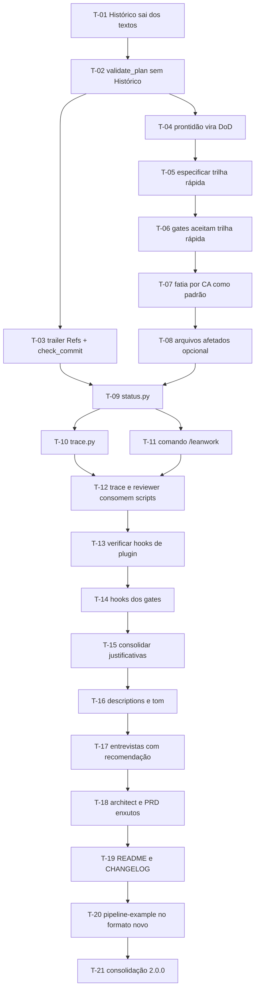

# Plano de Execução: Enxugamento do pipeline — cortar coreografia, manter verificação

**PRD de referência:** nenhum — plano derivado de revisão do pipeline frente à evolução dos modelos e da comparação com `tlc-spec-lean` (ver seção 3)
**Cliente/Produto:** Leanwork — plugin `leanwork-sdd` (o próprio repositório)
**Stack:** Markdown (skills e comandos do Claude Code) + Python 3.8+ stdlib (scripts de validação)
**Autor:** Mick Banagouro
**Data:** 2026-10-16
**Status:** Em execução

---

## 1. Resumo executivo *(obrigatória)*

O pipeline acerta na camada de verificação (gates com exit code, autor ≠ verificador, sensor de discriminação, evidência ou zero) e paga caro na camada de coreografia: estado duplicado em três lugares, tarefa de 30min-4h com um ciclo `/leanwork-execute` + `/leanwork-review` por tarefa (~1.250 linhas de instrução carregadas por ciclo), ausência de trilha curta para mudança pequena, análises estáticas (`/leanwork-next`, `/leanwork-trace`) feitas pelo modelo em vez de script, e prosa que repete a mesma justificativa em quatro arquivos.

A premissa do plano: os modelos atuais seguem instrução concisa, inferem contexto do repositório e sustentam execuções longas melhor do que quando o pipeline foi desenhado — mas continuam declarando conclusão sem prova, não enxergam o próprio erro e escrevem teste raso. Por isso o corte é assimétrico: **sai a coreografia, fica a verificação**. Documentação, rastreabilidade e auditoria não perdem nada; parte delas passa a vir do git e de scripts, que não divergem.

Seis fases em ordem de retorno sobre esforço: estado em fonte única → trilha rápida → fatia por `CA` → scripts no lugar de leitura → gates por hook → enxugamento de prosa e consolidação.

## 2. Estratégia de entrega *(obrigatória)*

**Modelo de entrega:** incremental por fase, na branch `improvement/comparativo-tlc-spec-lean`. Cada fase deixa o plugin consistente e com `selftest.py` verde. Release única ao final como **2.0.0**: remoção de comandos e da tabela de Histórico é quebra de contrato para quem já tem planos no formato antigo.

**Critério geral de "pronto":**

- `python scripts/selftest.py` sai com 0, cobrindo os validadores alterados e os scripts novos
- `python scripts/validate_plan.py` sai com 0 sobre este plano e sobre o fragmento de plano do `stacks/dotnet/pipeline-example.md`
- `claude plugin validate .` passa
- Métricas de enxugamento medidas e registradas no `CHANGELOG.md` contra a linha de base da seção 3
- `README.md`, `REFERENCES.md` e `plugin.json` refletem a 2.0.0

**Fora de escopo** (registrado para não virar scope creep): integração Jira/Confluence e intake (`docs/adocao-corporativa.md`), namespace de ADR por domínio, camada de lições (`LESSONS.md` do tlc), perfis `light/standard/ui` de verificação, review headless em CI. Todos são candidatos a planos seguintes.

## 3. Premissas e decisões *(obrigatória se houver)*

> ⚠️ **Premissa:** a fonte de comparação é a skill `tlc-spec-lean` v1.1.0 (Tech Leads Club, github.com/tech-leads-club, CC-BY-4.0), derivada de `tlc-spec-driven` 3.3.0 de Felipe Rodrigues, cópia local em `compare/tlc-spec-lean/`. O que se adota dela são **adaptações** — trilha curta para mudança pequena, "granularidade não é qualidade", ênfase restrita a regras pinadas, perguntas com recomendação. O pipeline Leanwork continua com plano em tarefas, IDs `RN/CA/ADR/UI/T/R` e Gherkin PT-BR, que não existem no tlc. T-21 credita no `REFERENCES.md`.

> ⚠️ **Premissa:** não há PRD, ADR nem SPEC-UI na origem — os campos `Implementa:`, `Valida:`, `Decisões base:` e `Telas:` estão **ausentes**, como no PLAN-001. A verificação de cada tarefa é inspeção objetiva dos critérios de aceite ou o `selftest.py`.

> ✅ **Fato verificado (T-13, 2026-10-19):** plugins do Claude Code distribuem hooks em `hooks/hooks.json`, que se somam aos hooks do usuário e do projeto quando o plugin é habilitado. Fonte: [code.claude.com/docs/en/hooks](https://code.claude.com/docs/en/hooks), conferida também no repositório `anthropics/claude-code` (`plugins/plugin-dev/skills/hook-development`). O que a documentação garante para a Fase 5:
> - **Evento:** `PostToolUse` com `matcher: "Write|Edit"` dispara depois da edição; o hook recebe por stdin o JSON com `tool_input.file_path`
> - **Filtro por caminho:** o campo `if` do handler aceita sintaxe de regra de permissão (ex.: `"Edit(*.ts)"`) e só é avaliado em eventos de ferramenta, `PostToolUse` incluído
> - **Falha devolvida ao modelo:** em `PostToolUse`, exit 2 não desfaz a edição (a ferramenta já rodou), mas mostra o stderr ao Claude, que reage a ele. Alternativa: JSON com `decision: "block"` e `reason`
> - **Caminho do plugin:** `${CLAUDE_PLUGIN_ROOT}` é substituído em `command` e em `args`; a forma exec (com `args`) é a recomendada para caminhos com placeholder
>
> Pontos que a documentação não fecha, resolvidos em T-14 (2026-10-19): o hook não usa o campo `if` — o filtro por caminho fica em `scripts/hook_gate.py`, sobre `tool_input.file_path` e `cwd`, o que elimina a dúvida sobre a base do caminho relativo; o executável é `python`, o mesmo que todas as instruções do plugin já usam (no Windows de teste, `python` e `python3` resolvem para o mesmo 3.11).

> ⚠️ **Premissa:** linha de base medida em 2026-10-16, para comparar ao final:
> - Ciclo execute + review: `commands/leanwork-execute.md` + `commands/leanwork-review.md` + `skills/reviewer-leanwork/SKILL.md` + `references/*` do reviewer = **1.258 linhas**
> - Soma das `description` das seis skills: **6.683 caracteres**
> - `README.md`: **425 linhas**
> - Passagens repetidas: "Degradação silenciosa" em 4 arquivos, "Sombra de prefixo" em 4, tabela "Quem sugere" em 3

Decisões já tomadas (não reabrir durante a execução sem passar pelo ponto de validação humana correspondente):

- **Decisão:** o campo `**Status:**` da tarefa é a única fonte de estado; o git é a trilha de auditoria. A tabela de Histórico de execução sai. Commit referencia a tarefa por trailer `Refs: T-XX, CA-XX`.
- **Decisão:** a unidade de trabalho passa a ser a **fatia por `CA-XX`** (um ou mais cenários fechados ponta a ponta). Fatia horizontal por camada vira exceção para fundação, migrations e refactor expandir-migrar-contrair. Reverte o padrão da v1.8.0 — a reversão é registrada em `REFERENCES.md`, não feita em silêncio.
- **Decisão:** trilha rápida reaproveita o formato de plano — um plano de uma tarefa, sem PRD, com os `CA-XX` definidos na própria tarefa — para que `/leanwork-execute`, `/leanwork-review` e os gates funcionem sem fluxo paralelo.
- **Decisão:** `/leanwork-start` e `/leanwork-next` fundem num comando `/leanwork-pipeline` (nome decidido no ponto de validação antes de T-11, sem alias); `/leanwork-prototype` e `/leanwork-context` saem, porque as skills já são invocáveis por `/leanwork-sdd:<skill>`.
- **Decisão:** a verificação não é tocada: gates, sub-agente verificador, sensor de discriminação, evidência ou zero e catálogo de permissões ficam como estão, salvo ajuste mecânico decorrente das mudanças de formato.

## 4. Mapa de dependências *(obrigatória se houver mais de 5 tarefas)*

`T-02` é gate da Fase 1: nenhuma mudança de formato posterior entra antes do selftest voltar ao verde. `T-13` é gate da Fase 5: se a verificação reprovar a premissa, T-14 fica `Bloqueado` com o motivo e T-15 segue sem ela.

## 5. Fases *(obrigatória)*

### Fase 1 — Estado em fonte única

**Objetivo da fase:** o estado da tarefa vive num lugar só, e a trilha de auditoria vem do git.

**Critério de conclusão da fase:** nenhum arquivo do plugin menciona a tabela de Histórico como obrigação; `selftest.py` verde; `check_commit.py` existe e é testado.

---

#### T-01 — Remover a tabela de Histórico de execução dos textos

- **Status:** Concluído
- **Complexidade:** Média
- **Depende de:** nenhuma
- **Camadas/arquivos afetados:**
  - `skills/planner-leanwork/references/plan-template.md` *(seção 11 e nota de vocabulário)*
  - `skills/planner-leanwork/SKILL.md` *(Padrões de comportamento — atualização durante a execução)*
  - `commands/leanwork-execute.md` *(Passo 7)*
  - `commands/leanwork-review.md` *(Passo 6)*
  - `commands/leanwork-next.md` e `commands/leanwork-trace.md` *(regras de divergência Status × Histórico)*
  - `templates/id-conventions.md`, `templates/folder-conventions.md`, `skills/context-leanwork/SKILL.md`, `skills/context-leanwork/references/claude-md-root-template.md`

**Descrição:**
O Histórico duplica o campo `**Status:**` e o git; o pipeline tem hoje regra só para detectar divergência entre os dois. Remover a seção do template e toda instrução que manda preenchê-la ou compará-la. O motivo de bloqueio, que hoje vai na coluna Observação, passa a ir numa linha `**Bloqueio:**` dentro do bloco da tarefa, com a referência `R-XX (REVIEW-...)` quando vier de review.

**Critério de aceite (testável):**
- [ ] `grep -rn "Histórico de execução" commands skills templates` não retorna instrução de preenchimento nem regra de divergência
- [ ] O template declara o campo `**Bloqueio:**` e `/leanwork-execute` e `/leanwork-review` o usam ao marcar `Bloqueado`
- [ ] Nenhuma outra regra de status foi alterada (vocabulário de quatro valores intacto)

**Testes a escrever:**
- *Não aplicável* — mudança em markdown de instrução; a parte executável vem em T-02.

**Riscos / pontos de atenção:**
- Planos já existentes em projetos consumidores mantêm a tabela; ela passa a ser ignorada, não proibida. Não transformar a presença dela em erro

---

#### T-02 — Ajustar `validate_plan.py` e o selftest ao plano sem Histórico

- **Status:** Concluído
- **Complexidade:** Baixa
- **Depende de:** T-01
- **Camadas/arquivos afetados:**
  - `scripts/validate_plan.py`
  - `scripts/selftest.py`

**Descrição:**
Remover a regra de divergência entre `**Status:**` e a tabela de Histórico e o caso correspondente no selftest. Adicionar a regra nova: tarefa com `Status: Bloqueado` sem campo `**Bloqueio:**` é ERROR. Plano antigo com tabela de Histórico continua passando.

**Critério de aceite (testável):**
- [ ] Plano sem Histórico e com tarefas válidas sai com exit 0
- [ ] Tarefa `Bloqueado` sem `**Bloqueio:**` sai com exit 1 nomeando a tarefa
- [ ] `python scripts/selftest.py` sai com 0, com caso novo para a regra de `Bloqueio`

**Testes a escrever:**
- *Integration:* fixture de tarefa bloqueada sem motivo (falha) e com motivo (passa) no `selftest.py`

---

#### T-03 — Trailer `Refs:` no commit e `check_commit.py`

- **Status:** Concluído
- **Complexidade:** Média
- **Depende de:** T-02
- **Camadas/arquivos afetados:**
  - `scripts/check_commit.py` *(novo)*
  - `scripts/selftest.py`
  - `templates/id-conventions.md` *(convenção do trailer)*
  - `commands/leanwork-execute.md` *(Passo 7 — mensagem sugerida)*

**Descrição:**
A rastreabilidade código → requisito passa a vir do `git log`. Convenção: trailer `Refs: T-04, CA-01, CA-03` na mensagem de commit. `check_commit.py --message "<msg>"` valida que o trailer existe, que os IDs são bem formados e, com `--plan`, que a `T-XX` existe no plano. `/leanwork-execute` sugere a mensagem já com o trailer. Referência de design: `compare/tlc-spec-lean/scripts/check_commit.py`.

**Critério de aceite (testável):**
- [ ] Mensagem sem trailer `Refs:` sai com exit 1; mensagem com trailer válido sai com 0
- [ ] Com `--plan`, `T-XX` inexistente no plano sai com exit 1
- [ ] O contrato de saída é o de `_common.py` (0/1/2, `--strict`)

**Testes a escrever:**
- *Integration:* casos válido, sem trailer, ID malformado e tarefa inexistente no `selftest.py`

---

#### T-04 — Checklist de prontidão sai do plano e vira Definition of Done

- **Status:** Concluído
- **Complexidade:** Baixa
- **Depende de:** T-02
- **Camadas/arquivos afetados:**
  - `skills/planner-leanwork/references/plan-template.md` *(seção 7)*
  - `skills/context-leanwork/references/claude-md-root-template.md` *(nova seção Definition of Done)*
  - `scripts/validate_plan.py` e `scripts/selftest.py` *(seção deixa de ser obrigatória)*

**Descrição:**
O checklist é genérico e se repete igual em todo plano. Passa a ser declarado uma vez no `CLAUDE.md` do projeto. O plano só registra itens de prontidão **específicos** da feature (migration destrutiva, flag) em `Estratégia de entrega`. Na mesma passada, o critério de aceite da tarefa deixa de exigir checkbox: lista simples, já que o estado vive em `**Status:**`.

**Critério de aceite (testável):**
- [ ] `validate_plan.py` não exige mais a seção `Checklist de prontidão` nem checkbox em critério de aceite, e continua exigindo ao menos um item de critério
- [ ] O template de `CLAUDE.md` raiz tem seção Definition of Done com os itens que saíram do plano
- [ ] `selftest.py` sai com 0

**Testes a escrever:**
- *Integration:* fixture de critério de aceite em lista simples (passa) e vazio (falha)

---

### Fase 2 — Trilha rápida

**Objetivo da fase:** mudança pequena e reversível deixa de exigir PRD e plano completo.

**Critério de conclusão da fase:** um plano de trilha rápida passa por `validate_plan.py` e `validate_ids.py` e é executável por `/leanwork-execute` e revisável por `/leanwork-review` sem alteração de fluxo.

---

#### T-05 — Especificar a trilha rápida

- **Status:** Concluído
- **Complexidade:** Média
- **Depende de:** T-04
- **Camadas/arquivos afetados:**
  - `skills/planner-leanwork/SKILL.md` *(seção nova "Trilha rápida")*
  - `skills/planner-leanwork/references/plan-template.md` *(variante curta)*
  - `templates/id-conventions.md`, `templates/folder-conventions.md`
  - `commands/leanwork-start.md` *(opção de entrada nova)*

**Descrição:**
Critério de entrada único, sem matriz de dimensionamento: **menos de ~3 arquivos tocados e nenhuma porta de mão única** (migration, contrato público, schema, permissão). Formato: plano com cabeçalho `**PRD de referência:** nenhum — trilha rápida`, uma tarefa, e os cenários `CA-XX` escritos em Gherkin dentro da própria tarefa. Sem fases, mapa, rollback ou pontos de validação além do que a mudança pedir. Review continua obrigatório. Se durante a execução a mudança crescer além do critério, a tarefa vira `Bloqueado` com motivo e o fluxo completo assume.

**Critério de aceite (testável):**
- [ ] O critério de entrada e a regra de saída (crescer → fluxo completo) estão escritos na SKILL do planner
- [ ] O template tem a variante curta e `id-conventions.md` declara que, na trilha rápida, `CA-XX` nasce no plano
- [ ] `/leanwork-start` oferece a trilha rápida como opção de entrada

**Testes a escrever:**
- *Não aplicável* — mudança em markdown de instrução; a parte executável vem em T-06.

---

#### T-06 — Gates aceitam o plano de trilha rápida

- **Status:** Concluído
- **Complexidade:** Média
- **Depende de:** T-05
- **Camadas/arquivos afetados:**
  - `scripts/validate_plan.py`, `scripts/validate_ids.py`, `scripts/selftest.py`

**Descrição:**
`validate_plan.py` reconhece a trilha rápida pelo cabeçalho e não exige as seções do plano completo, mas mantém o rigor da tarefa (critério de aceite, testes a escrever, status). `validate_ids.py` resolve `CA-XX` contra o próprio plano quando não há PRD. Trilha rápida com mais de uma tarefa é ERROR — é o sinal de que a mudança não cabe nela.

**Critério de aceite (testável):**
- [ ] Plano de trilha rápida válido passa nos dois gates com exit 0
- [ ] Trilha rápida com duas tarefas, ou com `CA-XX` citado e não definido no plano, sai com exit 1
- [ ] Planos completos existentes continuam passando sem alteração

**Testes a escrever:**
- *Integration:* fixtures de trilha rápida válida, com duas tarefas e com CA indefinido no `selftest.py`

---

### Fase 3 — Fatia por `CA` como unidade de trabalho

**Objetivo da fase:** menos ciclos execute + review por feature, cada um fechando comportamento demonstrável.

**Critério de conclusão da fase:** o padrão do planner é a fatia vertical por `CA-XX`, com a reversão da v1.8.0 registrada, e o campo de arquivos afetados restrito ao que é difícil de reverter.

---

#### T-07 — Inverter o padrão de fatiamento

- **Status:** Concluído
- **Complexidade:** Alta
- **Depende de:** T-06
- **Camadas/arquivos afetados:**
  - `skills/planner-leanwork/SKILL.md` *(Orientação da fatia, Granularidade)*
  - `skills/planner-leanwork/references/plan-template.md` *(seção 5)*
  - `skills/planner-leanwork/references/task-examples.md` e `stacks/dotnet/task-examples.md`
  - `templates/id-conventions.md` *(regra de `T-XX`)*
  - `REFERENCES.md` *(divergência de fatiamento)*

**Descrição:**
A fatia vertical por `CA-XX` passa a ser o padrão; horizontal fica para fundação, migrations e expandir-migrar-contrair. O teto de 30min-4h, calibrado para dev humano, é substituído por: uma fatia fecha um ou mais `CA-XX` ponta a ponta e cabe num ciclo de execução + review com a suíte verde ao final. Sinais de "grande demais" passam a ser comportamentais (mais de um caminho feliz, `CA` de features distintas), não horas. `REFERENCES.md` registra a reversão da v1.8.0 com o motivo: granularidade compra ordem, não correção, e cada tarefa custa um ciclo inteiro de instrução.

**Critério de aceite (testável):**
- [ ] A SKILL e o template descrevem vertical como padrão e listam as três exceções horizontais
- [ ] `id-conventions.md` não menciona mais teto em horas para `T-XX`
- [ ] `REFERENCES.md` registra a reversão, citando a v1.8.0 e a fonte da adaptação

**Testes a escrever:**
- *Não aplicável* — mudança em markdown de instrução.

**Riscos / pontos de atenção:**
- É reversão de decisão registrada do pipeline — passa pelo ponto de validação humana da seção 9 antes de começar
- O WARN de "mais de 3 critérios de aceite" do `validate_plan.py` pode ficar sensível demais com fatias maiores; avaliar o limiar aqui, sem removê-lo

---

#### T-08 — `Camadas/arquivos afetados` restrito a portas de mão única

- **Status:** Concluído
- **Complexidade:** Média
- **Depende de:** T-07
- **Camadas/arquivos afetados:**
  - `skills/planner-leanwork/references/plan-template.md`
  - `scripts/validate_plan.py`, `scripts/selftest.py`
  - `skills/reviewer-leanwork/SKILL.md` e `references/review-checklist.md` *(eixo 1)*
  - `commands/leanwork-execute.md` *(Passo 5)*

**Descrição:**
Onde o código mora é decisão reversível, respondida pelas convenções do repositório e visível no diff. O campo passa a se chamar `**Portas de mão única:**` e lista só o que é caro de reverter (migration, contrato público, schema, configuração de permissão), ou `nenhuma`. O eixo 1 do reviewer deixa de gerar finding de "escopo expandido" por arquivo extra e passa a cobrar só porta de mão única não declarada.

**Critério de aceite (testável):**
- [ ] `validate_plan.py` exige `**Portas de mão única:**` e não exige mais `Camadas/arquivos afetados`; plano antigo com o campo antigo gera WARN, não ERROR
- [ ] O eixo 1 do reviewer descreve a regra nova, e `/leanwork-execute` Passo 5 deixa de exigir justificativa por arquivo fora da lista
- [ ] `selftest.py` sai com 0

**Testes a escrever:**
- *Integration:* fixtures com campo novo (passa), campo ausente (falha) e campo antigo (WARN)

---

### Fase 4 — Scripts no lugar de leitura pelo modelo

**Objetivo da fase:** estado do pipeline e matriz de rastreabilidade saem de script determinístico; o modelo só interpreta.

**Critério de conclusão da fase:** `status.py` e `trace.py` existem e são testados; `/leanwork` substitui `/leanwork-start` e `/leanwork-next`; `/leanwork-trace` e os eixos mecânicos do reviewer consomem os scripts.

---

#### T-09 — `status.py`: estado do pipeline

- **Status:** Concluído
- **Complexidade:** Média
- **Depende de:** T-03, T-08
- **Camadas/arquivos afetados:**
  - `scripts/status.py` *(novo)*
  - `scripts/_common.py` *(parsing compartilhado de plano e review, extraído de `validate_plan.py` e `validate_review.py`)*
  - `scripts/selftest.py`

**Descrição:**
Lê `docs/` e emite o que hoje o `/leanwork-next` reconstrói lendo tudo: artefatos presentes, tarefas por status, tarefas `Concluído` sem review, reviews `Bloqueado` sem round seguinte, tarefa `Em andamento`, próxima tarefa elegível. Saída em markdown curto e, com `--json`, estruturada. Exit 0 sempre que conseguir ler; é relatório, não gate.

**Critério de aceite (testável):**
- [ ] Sobre um fixture de projeto, a saída lista corretamente as quatro categorias de pendência e a próxima tarefa elegível
- [ ] Parsing de plano e review vem de `_common.py`, sem duplicação com os validadores
- [ ] `selftest.py` sai com 0

**Testes a escrever:**
- *Integration:* fixture de projeto com uma tarefa em cada situação, conferindo a saída `--json`

---

#### T-10 — `trace.py`: matriz de rastreabilidade

- **Status:** Concluído
- **Complexidade:** Média
- **Depende de:** T-09
- **Camadas/arquivos afetados:**
  - `scripts/trace.py` *(novo)*
  - `scripts/selftest.py`

**Descrição:**
Gera a matriz `ADR ↔ RN ↔ CA ↔ UI ↔ T ↔ R` e a lista de lacunas que hoje o `/leanwork-trace` monta à mão (RN sem cenário, CA sem tarefa, ADR nunca citado, concluída sem review, estado de tela sem tarefa). Inclui a coluna de commits a partir do trailer `Refs:` (`git log`), quando houver git. Uma tabela e a lista de lacunas; o diagrama Mermaid fica opcional por flag.

**Critério de aceite (testável):**
- [ ] Sobre o fixture de T-09, cada categoria de lacuna aparece quando presente e some quando ausente
- [ ] Sem SPEC-UI, as colunas de UI são omitidas e não geram lacuna
- [ ] Sem git, a coluna de commits é omitida com aviso, não com erro

**Testes a escrever:**
- *Integration:* fixture com uma lacuna de cada categoria e fixture sem SPEC-UI

---

#### T-11 — Comando `/leanwork` substitui `start` e `next`; wrappers finos saem

- **Status:** Concluído
- **Complexidade:** Média
- **Depende de:** T-09
- **Camadas/arquivos afetados:**
  - `commands/leanwork.md` *(novo)*
  - `commands/leanwork-start.md`, `commands/leanwork-next.md`, `commands/leanwork-prototype.md`, `commands/leanwork-context.md` *(removidos)*
  - Referências a esses comandos em `skills/`, `templates/` e `README.md`

**Descrição:**
`/leanwork` roda `status.py`: sem artefatos, conduz a entrada (fluxo completo, trilha rápida, ponto de partida); com artefatos, sugere **uma** próxima ação pela mesma ordem de prioridade do `/leanwork-next` atual. Sugestões de `prototype-leanwork` e `context-leanwork` passam a citar `/leanwork-sdd:prototype-leanwork` e `/leanwork-sdd:context-leanwork`.

**Critério de aceite (testável):**
- [ ] `grep -rn "leanwork-start\|leanwork-next\|/leanwork-prototype\|/leanwork-context" commands skills templates README.md` só retorna menções históricas no Versionamento ou no CHANGELOG
- [ ] `/leanwork` declara que consome `status.py` e mantém o fallback de modo degradado
- [ ] `claude plugin validate .` passa

**Testes a escrever:**
- *Não aplicável* — mudança em markdown de instrução; o comportamento executável está em `status.py` (T-09).

**Riscos / pontos de atenção:**
- Remoção de comando quebra hábito de quem já usa o plugin — ponto de validação humana na seção 9

---

#### T-12 — `/leanwork-trace` e os eixos mecânicos do reviewer consomem scripts

- **Status:** Concluído
- **Complexidade:** Média
- **Depende de:** T-10, T-11
- **Camadas/arquivos afetados:**
  - `commands/leanwork-trace.md`
  - `skills/reviewer-leanwork/SKILL.md`, `references/review-checklist.md`
  - `commands/leanwork-review.md` *(payload do verificador)*

**Descrição:**
`/leanwork-trace` passa a rodar `trace.py` e só interpretar as lacunas. No reviewer, o eixo 2 (rastreabilidade) consome `check_commit.py` sobre os commits da tarefa em vez de inspeção manual; o eixo 1 consome a lista de portas de mão única de T-08. O julgamento do verificador fica concentrado nos eixos 3, 4 (com o sensor) e 6. O eixo 5 fica restrito ao que o `CLAUDE.md` do projeto declara, sem a lista de critérios universais genéricos.

**Critério de aceite (testável):**
- [ ] `commands/leanwork-trace.md` tem menos da metade das linhas atuais (139) e invoca `trace.py`
- [ ] Os eixos 1 e 2 do reviewer citam o script de que dependem e o fallback quando ele não roda
- [ ] O payload do verificador em `/leanwork-review` inclui a saída de `check_commit.py`

**Testes a escrever:**
- *Não aplicável* — mudança em markdown de instrução.

---

### Fase 5 — Gates disparados por hook

**Objetivo da fase:** gate roda por mecanismo do harness, não por o modelo lembrar da instrução.

**Critério de conclusão da fase:** hooks do plugin rodam os validadores após edição dos artefatos, ou a inviabilidade está registrada com a fonte.

---

#### T-13 — Verificar suporte a hooks em plugin na documentação oficial

- **Status:** Concluído
- **Complexidade:** Baixa
- **Depende de:** T-12
- **Camadas/arquivos afetados:**
  - `docs/plans/PLAN-002-enxugamento-pipeline.md` *(registro do resultado na seção 3)*

**Descrição:**
Confirmar, na documentação oficial do Claude Code, se um plugin distribui hooks, quais eventos existem para edição de arquivo, como filtrar por caminho, como o hook devolve falha ao modelo e como se referencia `${CLAUDE_PLUGIN_ROOT}`. Registrar a resposta com o link da fonte na premissa correspondente.

**Critério de aceite (testável):**
- [ ] A premissa sobre hooks na seção 3 foi substituída por fato verificado, com link da fonte
- [ ] Se o suporte não existir ou não cobrir o caso, T-14 está marcada `Bloqueado` com o motivo em `**Bloqueio:**`

**Testes a escrever:**
- *Não aplicável* — tarefa de verificação documental.

---

#### T-14 — Hooks que rodam os gates

- **Status:** Concluído
- **Complexidade:** Média
- **Depende de:** T-13
- **Camadas/arquivos afetados:**
  - `hooks/hooks.json` *(novo)*
  - `scripts/hook_gate.py` *(novo — filtra o caminho e escolhe o validador)*, `scripts/selftest.py` *(casos do hook)*
  - `.claude-plugin/plugin.json` *(se a declaração for necessária)*
  - `skills/planner-leanwork/SKILL.md`, `commands/leanwork-execute.md`, `commands/leanwork-review.md` *(instrução de gate reduzida)*

**Descrição:**
Edição em `docs/plans/**` dispara `validate_plan.py`; em `docs/reviews/**`, `validate_review.py`. Falha volta ao modelo como bloqueio. As skills e comandos deixam de carregar o parágrafo de gate e ficam com uma linha apontando o hook e o fallback. `validate_ids.py` continua chamado por `/leanwork-execute`, porque não depende de edição.

**Critério de aceite (testável):**
- [ ] Editar um plano inválido numa sessão com o plugin carregado produz o bloqueio do hook
- [ ] Os três arquivos de instrução descrevem o gate em no máximo três linhas cada
- [ ] `claude plugin validate .` passa

**Testes a escrever:**
- *Integration:* teste manual registrado no CHANGELOG — editar fixture inválido e válido com `claude --plugin-dir .` e anotar o resultado

---

### Fase 6 — Enxugamento de prosa e consolidação

**Objetivo da fase:** cada regra escrita uma vez, ênfase só no que é inviolável, e a 2.0.0 publicada com métricas.

**Critério de conclusão da fase:** métricas da seção 3 remedidas e registradas; plugin validado; selftest verde.

---

#### T-15 — Consolidar justificativas repetidas

- **Status:** Concluído
- **Complexidade:** Média
- **Depende de:** T-14
- **Camadas/arquivos afetados:**
  - `README.md`, `REFERENCES.md`
  - `commands/*.md`, `skills/*/SKILL.md` *(remoção das repetições)*

**Descrição:**
"Degradação silenciosa é pior que gate nenhum", o parágrafo "Sombra de prefixo entre baldes" e a tabela "Quem sugere" ficam escritos uma vez, no README ou no `REFERENCES.md`. Nos demais arquivos sobra a regra em uma linha, com link quando necessário.

**Critério de aceite (testável):**
- [ ] Cada uma das três passagens aparece por extenso em exatamente um arquivo
- [ ] Nenhuma regra foi perdida: cada arquivo que tinha a passagem mantém a regra operacional correspondente

**Testes a escrever:**
- *Não aplicável* — mudança em markdown de instrução; conferência por `grep`.

---

#### T-16 — Descriptions curtas e ênfase restrita

- **Status:** Concluído
- **Complexidade:** Média
- **Depende de:** T-15
- **Camadas/arquivos afetados:**
  - `skills/*/SKILL.md` *(frontmatter e corpo)*

**Descrição:**
Cada `description` fica com gatilhos e exclusões, em torno de 300 caracteres — o resto está no corpo da skill. Cada SKILL ganha uma seção curta de regras pinadas (3 a 5), e o restante do texto perde caixa alta e negrito de alarme. Modelos atuais tendem a sobre-reagir a ênfase difusa; ênfase concentrada mantém o peso onde importa.

**Critério de aceite (testável):**
- [ ] Soma das `description` das seis skills abaixo de 2.500 caracteres
- [ ] Cada SKILL tem seção de regras pinadas com no máximo 5 itens
- [ ] Ocorrências de `NUNCA`, `PARE` e `NÃO` em caixa alta fora das regras pinadas caem a menos da metade da contagem atual

**Testes a escrever:**
- *Não aplicável* — mudança em markdown de instrução; conferência por contagem.

---

#### T-17 — Entrevistas com busca primeiro e recomendação

- **Status:** Concluído
- **Complexidade:** Média
- **Depende de:** T-16
- **Camadas/arquivos afetados:**
  - `skills/architect-leanwork/SKILL.md`, `skills/prd-leanwork/SKILL.md`, `skills/planner-leanwork/SKILL.md`, `skills/prototype-leanwork/SKILL.md` *(Fase 1 — entrevista)*

**Descrição:**
Regra comum às quatro: fato se busca no repositório e nos artefatos; decisão se pergunta, no máximo duas por vez, com opções concretas e a recomendação. Os blocos de perguntas viram lista de **dimensões a cobrir**, cada uma respondida ou marcada `n/a — motivo`, em vez de roteiro de perguntas.

**Critério de aceite (testável):**
- [ ] As quatro skills declaram a regra busca-antes-de-perguntar e o limite de duas decisões por vez com recomendação — *revisto por Mick em 2026-10-19 após teste A/B: o limite de duas por vez deixava a entrevista rasa por rodada; vale um bloco de dimensões inteiro por rodada, com recomendação em toda pergunta de decisão*
- [ ] Os blocos de entrevista estão em formato de dimensões com `n/a — motivo` obrigatório
- [ ] Nenhuma dimensão hoje coberta foi removida sem registro

**Testes a escrever:**
- *Não aplicável* — mudança em markdown de instrução.

---

#### T-18 — Architect e PRD sem conteúdo de livro-texto

- **Status:** Concluído
- **Complexidade:** Média
- **Depende de:** T-17
- **Camadas/arquivos afetados:**
  - `skills/architect-leanwork/SKILL.md`
  - `skills/prd-leanwork/SKILL.md`, `skills/prd-leanwork/references/prd-template.md`

**Descrição:**
No architect, saem a explicação de Cynefin, a lista genérica de trade-offs, a explicação dos níveis do C4 e os princípios de escrita genéricos; ficam as opiniões Leanwork (restrição como restrição, sem modismo, sem estimativa, regra de escolha do nível C4). No PRD, a hierarquia Epic→Feature→PBI passa a opcional, para quem cadastra no Azure DevOps, e o template perde seções que repetem o que os cenários Gherkin já dizem. Os catálogos em `references/` ficam, porque só carregam sob demanda e servem de documentação para pessoas.

**Critério de aceite (testável):**
- [ ] `skills/architect-leanwork/SKILL.md` com no máximo 150 linhas (hoje 248), mantendo o checklist final — *revisto em 2026-10-19 após teste A/B contra a 1.10.0: as listas de trade-offs e de isomorfismo e a regra do jargão voltaram; o arquivo fica com 165 linhas*
- [ ] A hierarquia Epic→Feature→PBI está marcada como opcional no template e na SKILL do PRD — *teste A/B em 2026-10-19: a seção 7 do template voltou a "Fluxos" (principal, outros fluxos, mapa de desvios) depois que o corte para "Fluxo principal" eliminou os diagramas dos fluxos secundários*
- [ ] As seções obrigatórias do PRD continuam incluindo regras `RN-XX` e cenários `CA-XX`

**Testes a escrever:**
- *Não aplicável* — mudança em markdown de instrução.

---

#### T-19 — README enxuto e `CHANGELOG.md`

- **Status:** Concluído
- **Complexidade:** Baixa
- **Depende de:** T-18
- **Camadas/arquivos afetados:**
  - `README.md`
  - `CHANGELOG.md` *(novo)*

**Descrição:**
A seção Versionamento migra inteira para `CHANGELOG.md`. O README descreve o pipeline 2.0: comandos atuais, trilha rápida, fatia por `CA`, scripts e hooks.

**Critério de aceite (testável):**
- [ ] `README.md` com no máximo 250 linhas (hoje 425)
- [ ] `CHANGELOG.md` contém todo o histórico de 1.0.0 a 1.10.0 sem perda

**Testes a escrever:**
- *Não aplicável* — documentação.

---

#### T-20 — Exemplo end-to-end no formato novo

- **Status:** Concluído
- **Complexidade:** Média
- **Depende de:** T-19
- **Camadas/arquivos afetados:**
  - `stacks/dotnet/pipeline-example.md`
  - `scripts/selftest.py` *(casos do exemplo)*, `scripts/trace.py` *(regra quebrada em várias linhas)*

**Descrição:**
O fragmento de plano passa a usar fatia por `CA`, `**Portas de mão única:**`, `**Bloqueio:**` e commit com trailer `Refs:`, sem tabela de Histórico. A matriz do exemplo é a saída do `trace.py` sobre esses fragmentos.

**Critério de aceite (testável):**
- [ ] O fragmento de plano, extraído para arquivo, passa em `validate_plan.py` com exit 0
- [ ] A matriz do exemplo é idêntica à saída do `trace.py` sobre os fragmentos

**Testes a escrever:**
- *Integration:* caso no `selftest.py` que extrai o fragmento de plano do exemplo e roda o validador, para o exemplo não apodrecer

---

#### T-21 — Consolidação e versão 2.0.0

- **Status:** Pendente
- **Complexidade:** Baixa
- **Depende de:** T-20
- **Camadas/arquivos afetados:**
  - `.claude-plugin/plugin.json`, `.claude-plugin/marketplace.json`
  - `REFERENCES.md`, `CHANGELOG.md`
  - `templates/id-conventions.md`, `templates/folder-conventions.md` *(varredura final)*

**Descrição:**
Versão 2.0.0. `CHANGELOG.md` registra as quebras de contrato (comandos removidos, Histórico removido, campo de arquivos renomeado) e as métricas antes/depois contra a linha de base da seção 3. `REFERENCES.md` credita o `tlc-spec-lean` marcando o que é adaptação. Varredura de `templates/` pela regra de manutenção do README.

**Critério de aceite (testável):**
- [ ] `claude plugin validate .` e `python scripts/selftest.py` saem com 0
- [ ] `CHANGELOG.md` tem a tabela de métricas antes/depois das quatro medidas da seção 3
- [ ] `REFERENCES.md` credita a fonte com licença e marca adaptação

**Testes a escrever:**
- *Não aplicável* — consolidação; a verificação é o selftest e o validate do plugin.

---

## 7. Checklist de prontidão para produção *(obrigatória)*

Mantido porque o `validate_plan.py` atual ainda o exige; T-04 retira essa obrigação.

- [ ] `selftest.py` verde
- [ ] `claude plugin validate .` verde
- [ ] Instalação limpa via marketplace local testada (`claude plugin marketplace update leanwork`)
- [ ] Métricas antes/depois registradas no `CHANGELOG.md`
- [ ] `REFERENCES.md` com crédito da fonte

## 8. Rollback e contingência *(obrigatória se houver migration ou breaking change)*

A 2.0.0 é quebra de contrato para projetos que usam o plugin. Rollback é reinstalar a 1.10.0 a partir da tag correspondente; planos no formato antigo continuam válidos na 2.0.0 (Histórico ignorado, campo antigo de arquivos com WARN), então o caminho de ida não exige migração de artefatos.

## 9. Pontos de validação humana *(obrigatória)*

- [x] Antes de **T-07** — confirmar a reversão do padrão de fatiamento da v1.8.0 — *aprovado por Mick em 2026-10-19: vertical por `CA-XX` vira padrão; horizontal só para fundação, migrations e expandir-migrar-contrair*
- [x] Antes de **T-11** — confirmar a remoção de `/leanwork-start`, `/leanwork-next`, `/leanwork-prototype` e `/leanwork-context` — *aprovado por Mick em 2026-10-19, com o comando novo chamado `/leanwork-pipeline` em vez de `/leanwork`*
- [x] Após **T-13** — decidir se a Fase 5 segue, com base no que a documentação confirmou — *aprovado por Mick em 2026-10-19, ao pedir a execução das tarefas restantes*
- [ ] Antes de **T-21** — revisar as métricas antes/depois e aprovar a publicação da 2.0.0

## 10. Questões em aberto *(opcional)*

- [x] O limiar de 3 critérios de aceite do WARN do `validate_plan.py` continua fazendo sentido com fatias por `CA`? — *responsável: Mick* — *decidido em 2026-10-19: WARN mantido, limiar sobe para 5*
- [x] Vale manter `/leanwork-start` como alias de `/leanwork` por uma versão, para suavizar a transição? — *responsável: Mick* — *decidido em 2026-10-19: sem alias; a entrada única é `/leanwork-pipeline`*
