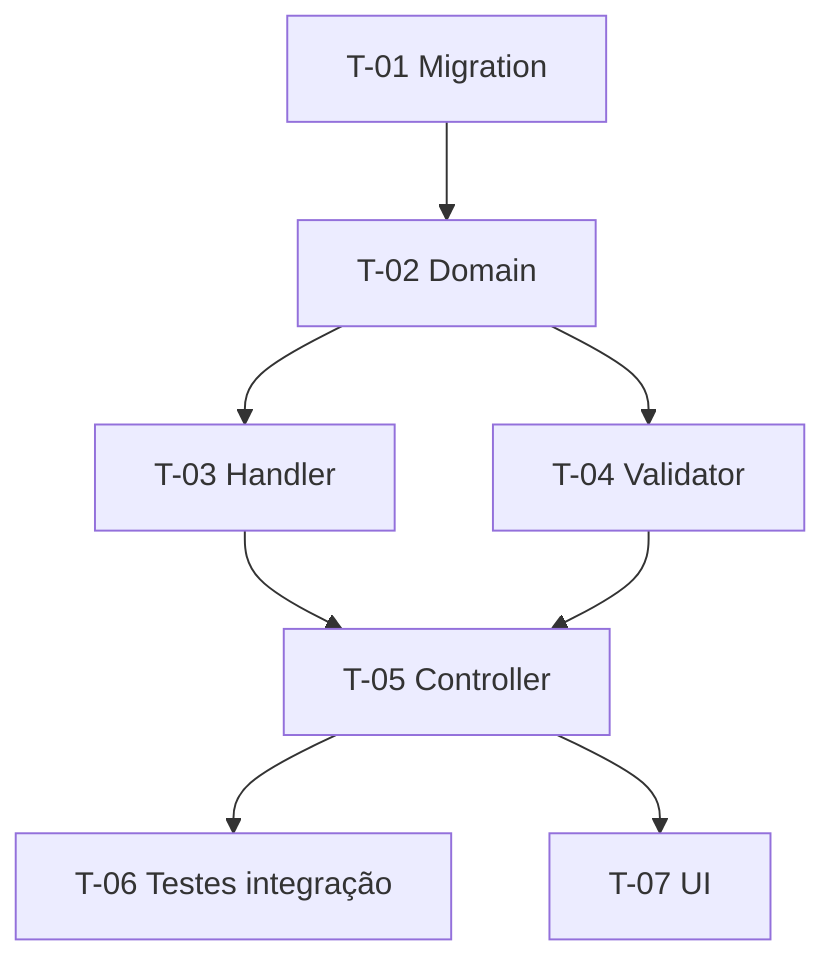

# Template — Plano de Execução

Template completo a ser preenchido. Manter hierarquia de headings e ordem das seções. Seções não aplicáveis podem ser omitidas, exceto as marcadas como obrigatórias.

Para mudança pequena e reversível, a variante curta está em `plan-template-quick.md` — critério de entrada em `SKILL.md`, seção "Trilha rápida".

As cercas de quatro crases que delimitam o bloco abaixo são o envelope deste arquivo — não fazem parte do documento gerado. As cercas de três crases dentro dele fazem.

---

````markdown
# Plano de Execução: [Título da feature/demanda]

**PRD de referência:** [link ou caminho para o arquivo do PRD]
**Cliente/Produto:** [Contoso / LeanOps / Projeto X / ...]
**Stack:** [linguagem, framework, banco de dados, frontend — ex.: Node.js/NestJS, PostgreSQL, React]
**Autor:** [nome]
**Data:** [AAAA-MM-DD]
**Status:** [Rascunho / Em execução / Concluído]

---

## 1. Resumo executivo *(obrigatória)*

[1 parágrafo: o que vamos construir e qual a estratégia geral de quebra. Ex.: "Implementação incremental começando pela camada de domínio, expondo via API ao final, com feature flag para liberação controlada."]

## 2. Estratégia de entrega *(obrigatória)*

[Como esse plano será executado: tudo de uma vez? Em fases? Há feature flag? Há dark launch?]

**Modelo de entrega:** [única release / incremental por fase / atrás de feature flag]

**Critério geral de "pronto":** [o que precisa estar verdadeiro para considerar a feature inteira concluída. O genérico — testes passando, review aprovado, documentação atualizada — já está na Definition of Done do `CLAUDE.md` do projeto e não se repete aqui]

**Prontidão específica:** [só o que é próprio desta feature — migration destrutiva testada em ambiente espelhado, feature flag desligada por padrão, janela de deploy. Omitir se não houver]

## 3. Premissas e decisões *(obrigatória se houver)*

Listar premissas que afetam o plano. Cada premissa precisa ser explícita — se virar falsa, o plano muda.

> ⚠️ **Premissa:** [descrição da premissa]
> ⚠️ **Premissa:** [outra premissa]

Decisões técnicas relevantes já tomadas (referenciar ADR se houver):

- **Decisão:** [ex.: Usaremos um pipeline centralizado de handlers para comandos e queries] — *referência: ADR-007*

## 4. Mapa de dependências *(obrigatória se houver mais de 5 tarefas)*

Diagrama mostrando a ordem natural de execução e o que bloqueia o quê.



## 5. Fases *(obrigatória)*

Agrupar tarefas em fases lógicas. Uma fase é um conjunto de tarefas que entrega valor coerente e pode (em tese) ser interrompida sem deixar o sistema quebrado.

O padrão é a **fatia vertical**: cada tarefa fecha um ou mais `CA-XX` ponta a ponta, atravessando as camadas necessárias. Fases agrupam fatias por incremento de comportamento, não por camada. Exemplo de fases típicas:

- **Fase 1 — Fundação** *(horizontal, quando houver)*: estrutura que toda fatia usa e migrations iniciais
- **Fase 2 — Caminho feliz:** uma fatia por cenário principal (`CA-XX`), cada uma demonstrável ao final. Quando existir SPEC-UI, a fatia declara `Telas:` com os `UI-XX` e estados que implementa; componentes reutilizáveis da SPEC-UI viram tarefa própria, consumida pelas fatias
- **Fase 3 — Erros e bordas:** fatias pelos cenários de erro, limite e concorrência
- **Fase 4 — Liberação:** feature flag, observabilidade e o que a estratégia de entrega pedir

Fatia horizontal (uma camada por tarefa) só em três casos: fundação, migrations e refactor sequenciado como expandir → migrar → contrair. Ver `SKILL.md`, seção "Orientação da fatia", e Exemplo 6 de `task-examples.md`.

Adaptar conforme a natureza da feature. Mudança pequena e reversível tem a trilha rápida (`plan-template-quick.md`).

### Fase 1 — [nome da fase]

**Objetivo da fase:** [1 frase]

**Critério de conclusão da fase:** [o que precisa estar verdadeiro para fechar a fase]

---

#### T-01 — [Título curto e imperativo da tarefa]

- **Status:** Pendente
- **Bloqueio:** [motivo — só quando `Status: Bloqueado`; se vier de review, citar `R-XX (REVIEW-T-XX-data)`. Omitir nos demais status]
- **Complexidade:** [Baixa / Média / Alta]
- **Depende de:** [nenhuma | T-XX, T-YY]
- **Implementa:** [RN-XX, RN-YY] *(regras de negócio do PRD que esta tarefa concretiza — vazio se for tarefa puramente estrutural)*
- **Valida:** [CA-XX, CA-YY] *(cenários Gherkin do PRD que ficarão verdes ao concluir — vazio se for tarefa preparatória)*
- **Decisões base:** [ADR-XX] *(decisões arquiteturais que esta tarefa materializa — opcional)*
- **Telas:** [UI-XX (estados)] *(telas e estados da SPEC-UI que esta tarefa implementa — apenas em tarefas de interface; omitir quando o projeto não tem SPEC-UI)*
- **Portas de mão única:** [nenhuma | o que é caro de reverter: migration, contrato público, schema, configuração de permissão — com o item concreto, ex.: `contrato público — rota POST /api/foo`] *(onde o código mora é decisão reversível, respondida pelas convenções do repositório e visível no diff — não listar arquivos)*

**Descrição:**
[O que essa tarefa faz, em 2-4 linhas. Explicar o "como" em alto nível — não código, mas direção. As regras de negócio implementadas já estão em **Implementa:**; aqui você pode aprofundar nuances de implementação.]

**Critério de aceite (testável):**
- [Critério 1 — verificável por teste ou inspeção objetiva]
- [Critério 2]

**Testes a escrever:**
- *Unit:* [descrever cenários — ex.: "Handler retorna sucesso quando comando válido", "Validator rejeita nome vazio"]
- *Integration:* [descrever cenários ligados a CA-XX — ex.: "POST /api/foo persiste no banco e retorna 201 (CA-01)"]
- *Não aplicável* se a tarefa for puramente estrutural (ex.: criação de pasta, ajuste de namespace).

**Riscos / pontos de atenção:**
- [ex.: "Tabela existente tem 2M de registros — migration precisa ser online"]
- [ex.: "Nome do campo conflita com palavra reservada em SQL Server — usar `[Order]` com escape"]

> **Vocabulário de status (fixo — os comandos dependem dele):** `Pendente` | `Em andamento` | `Concluído` | `Bloqueado`.
> Escrever exatamente essas palavras no campo `**Status:**` da tarefa, por extenso e sem emoji. `/leanwork-pipeline` e
> `/leanwork-trace` leem esse campo literalmente: qualquer outra grafia torna a tarefa invisível para eles.
> `Bloqueado` exige o campo `**Bloqueio:**` com o motivo. O plano não guarda histórico: quando e em que commit
> cada tarefa mudou é trilha do git.
> Referência canônica: `templates/id-conventions.md`.

---

#### T-02 — [...]

[mesma estrutura]

---

### Fase 2 — [nome da fase]

[mesma estrutura, começando da próxima tarefa T-NN]

## 6. Testes transversais *(opcional)*

Testes que não pertencem a uma tarefa específica mas precisam existir antes do fechamento da feature.

- [ ] **Smoke test end-to-end:** [descrição]
- [ ] **Teste de carga:** [se aplicável, com cenário e limite esperado]
- [ ] **Teste de regressão:** [áreas adjacentes que precisam ser revalidadas]

## 7. Rollback e contingência *(obrigatória se houver migration ou breaking change)*

[Plano de rollback caso a feature precise ser revertida em produção. Detalhar:
- Como reverter migrations (ou se são forward-only)
- Como desativar via feature flag
- Quais dados ficarão inconsistentes e como reconciliar]

## 8. Pontos de validação humana *(obrigatória)*

Tarefas onde o executor (especialmente se for agente de IA) DEVE parar e pedir confirmação antes de seguir:

- [ ] Após **T-XX** (migration criada) — revisar SQL gerado antes de aplicar em ambiente compartilhado
- [ ] Após **Fase N** (lógica de negócio pronta) — revisar regras implementadas com PO antes de expor via API
- [ ] Antes de **T-YY** (deploy em staging) — confirmar que feature flag está desligada por padrão

## 9. Questões em aberto *(opcional)*

Pontos que apareceram durante o planejamento e precisam ser resolvidos antes ou durante a execução.

- [ ] [pergunta] — *responsável: [nome]* — *bloqueia: T-XX*
- [ ] [pergunta] — *responsável: [nome]*

````
